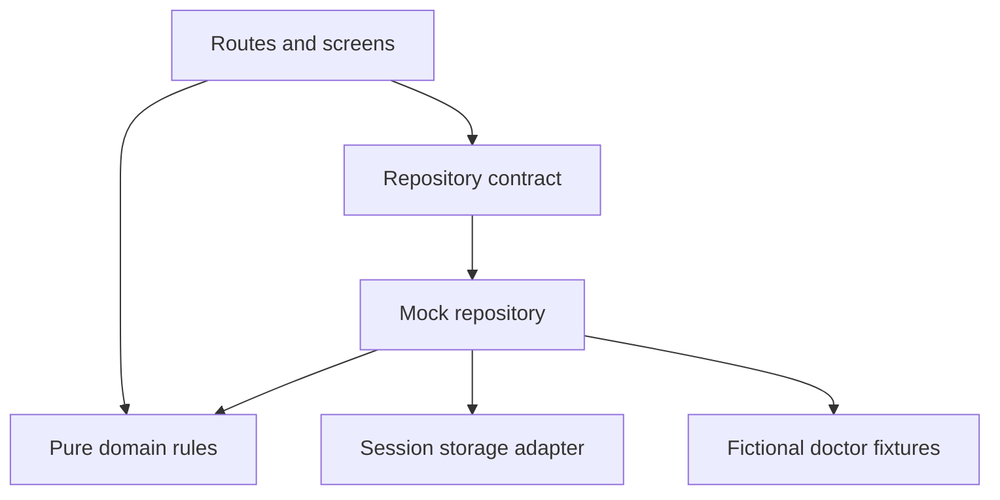

# MediConnect

**Find a doctor. Understand your options. Choose a time.**

An original, runnable doctor-discovery and appointment web app inspired by the core patient journey in the supplied Practo clone. This is the frontend foundation for the MediConnect Spring Boot project discussed earlier. It uses fictional data and a mock repository; it does not implement the microservice backend yet.

## Run it

Use Node.js **24 LTS** and npm. No API keys, database, Google account, or payment provider is required.

```bash
npm ci
npm run dev
```

Open `http://localhost:5173`. Stop the development server with Ctrl+C.

```bash
npm test             # domain, persistence, and rendered user-flow tests
npm run typecheck    # strict TypeScript checks
npm run build        # typecheck + production build in dist/
npm run preview      # serve that build locally at http://localhost:4173
```

The archive includes a lockfile. Prefer `npm ci` for the checked dependency set. For a manually reconstructed copy without the lockfile, run `npm install` first.

## What works

- Search fictional doctors by name, specialty, clinic, or area.
- Combine location, specialty, and maximum-fee filters; sort by name, fee, or experience.
- Open a dedicated profile with qualifications, clinic, languages, fee, and appointment times.
- Select a 30-minute slot from the next seven days and confirm fictional patient details.
- Review confirmed and cancelled appointments; cancel with explicit confirmation.
- Reload the same tab without losing demo appointments.
- Recover from empty results, unavailable slots, invalid doctor links, and data-layer errors.
- Responsive layouts, native labelled controls, keyboard focus states, a skip link, and status messages.

All scheduling and display use **Asia/Kolkata** (IST), regardless of the visitor’s computer timezone. Slots start tomorrow to avoid misleading same-day availability. Every doctor follows one simple mock schedule; real per-doctor calendars are a backend concern.

Use the prefilled **Demo Patient / 9876543210** details. No contact messages or real bookings are sent. Do not enter real personal or health information.

## Stack and reasoning

| Choice                                | Reason                                                                                              |
| ------------------------------------- | --------------------------------------------------------------------------------------------------- |
| React 19                              | Reusable interactive screens, matching the React direction of your earlier interview preparation    |
| TypeScript 7, strict mode             | Explicit Doctor, Slot, Appointment, and repository contracts; catches mismatched data at build time |
| Vite 8                                | Small SPA setup, quick dev server, production bundling                                              |
| React Router 7                        | Separate discovery/profile/booking/history routes and URL-driven search state                       |
| React context + local component state | Context injects the repository; forms stay local; there is no unnecessary global Redux store        |
| CSS with shared design tokens         | Original cream/forest-green visual system, responsive grids, no copied branded assets or layout     |
| Native Intl and Date                  | Explicit clinic timezone without Moment or a date dependency                                        |
| Vitest 5 + Testing Library + jsdom    | Pure business-rule tests, adapter tests, and a rendered booking/cancellation journey                |
| sessionStorage mock adapter           | No credentialed backend; refresh persistence scoped to the tab’s demo session                       |

Dependencies are pinned/locked in package.json and package-lock.json. The UI’s own runtime has no third-party network calls, remote fonts, or external images. The dev tools may connect locally for hot module updates.

## Architecture: features first, dependency boundaries second



- `src/app/`: routes, shared page shell, and repository injection.
- `src/features/doctors/`: Doctor model, pure search logic, discovery and profile UI.
- `src/features/appointments/`: Slot/Appointment models, pure booking/cancellation rules, booking/history UI.
- `src/data/`: repository contract, doctor fixtures, storage adapter, and mock implementation.
- `src/config/`: specialty/location catalog and demo configuration. Selects and specialty tiles are generated from this catalog.
- `src/shared/`: date formatting, avatars, load/error UI, and the async loading hook.
- `src/main.tsx`: composition root; this is the only place that chooses the concrete mock adapter.

Screens never access sessionStorage directly or embed backend URLs. Domain functions do not depend on React, routing, or storage. The mock adapter validates a booking again at submission time and reports storage failures before the UI shows success.

Search uses `q`, `city`, `specialty`, `fee`, and `sort` query parameters so a filtered view is reloadable/shareable. Patient names and phone numbers are never placed in URLs. Form drafts belong to the booking screen. Confirmation is identified by an opaque appointment ID.

## Routes

| Route                          | Purpose                                                  |
| ------------------------------ | -------------------------------------------------------- |
| `/` or `/doctors`              | Discovery and filters                                    |
| `/doctors/:doctorId`           | Dedicated doctor profile and slots                       |
| `/book/:doctorId?slot=:slotId` | Patient details and confirmation                         |
| `/appointments`                | This demo session’s appointment history and cancellation |
| Any other route                | Useful not-found screen                                  |

Static hosts require an SPA fallback to `index.html` for deep links. Vite development and preview servers handle these routes locally. Run the app through a server; do not double-click index.html.

## Booking consistency and limits

`reserveSlot` validates the patient name, Indian mobile format, doctor/slot relationship, future time, and existing confirmed appointments. `cancelBooking` preserves history and releases the slot. Repository writes re-read the session immediately before checking/saving. The simultaneous-submission test proves that one of two duplicate submissions fails **within this mock JavaScript session**.

This is **not** distributed booking protection. Separate tabs, devices, or users have independent mock sessions. Browser storage is editable, unencrypted, and not a patient account. Session storage normally lasts for the tab session and may be restored by the browser. No JWT, RBAC, healthcare records, or real patient identity is claimed here. Storage errors are visible instead of silently replacing bookings with an empty list.

The Spring Boot Appointment service must enforce booking atomically in MySQL. Redis caches and client-side disabled buttons must not be the source of truth.

## Connecting this frontend to your MediConnect services later

Implement `HealthcareRepository` in a new `src/data/httpRepository.ts`, then change repository construction in `src/main.tsx`. Keep the mock adapter for tests and standalone demos. Adapt server DTOs at this boundary rather than teaching every component about service payloads.

Proposed gateway contracts (not implemented endpoints):

| Adapter operation | Future gateway API                          | Owning service                  |
| ----------------- | ------------------------------------------- | ------------------------------- |
| list/get doctors  | `GET /api/doctors`, `GET /api/doctors/{id}` | Doctor                          |
| list slots        | `GET /api/doctors/{id}/slots`               | Appointment owns slot inventory |
| book              | `POST /api/appointments`                    | Appointment                     |
| list appointments | `GET /api/appointments/me`                  | Appointment                     |
| cancel            | `POST /api/appointments/{id}/cancel`        | Appointment                     |

Booking requests should identify an authenticated patient and slot, not trust an arbitrary client-provided role or patient ID. The backend derives authoritative doctor/slot/fee values. Return `409` for a taken slot; the adapter turns that into a useful booking error. Use authenticated ownership checks for history and cancellation. Doctor profiles live in Doctor service, patient identity/profile in Patient/Auth, and slot/booking state in Appointment. Start with synchronous REST for these screens; add Kafka notifications independently after a booking commits.

Suggested full-project layout when backend work begins:

```text
mediconnect/
  frontend/                 # this starter, moved intact
  backend/
    discovery-server/
    api-gateway/
    auth-service/
    patient-service/
    doctor-service/
    appointment-service/
    notification-service/   # later phase
  infrastructure/
    compose.yaml
```

Those backend directories are a future plan, not empty modules shipped as if implemented. Keep the earlier build sequence: infrastructure/patient → discovery/gateway → auth/RBAC → doctor → appointment/concurrency → Kafka → Redis/resilience.

## Learning / implementation order inside this starter

1. Read `config/catalog.ts` and the typed models: agree on shared vocabulary.
2. Read and run the search tests: understand combined filters and deterministic sorting.
3. Read `booking.ts` and its tests: understand slot identity, timestamps, validation, and cancellation.
4. Read the repository interface and mock implementation: understand the data boundary.
5. Read `DiscoveryPage` and `ProfilePage`: connect URL state to data and navigation.
6. Read `BookingPage` and `AppointmentsPage`: follow submit → data write → confirmation → cancellation.
7. Replace the adapter only when the real backend contracts are ready.

See `docs/REFERENCE_REVIEW.md` for the review and side-by-side comparison. `SOURCE_GUIDE.md` contains the complete file tree and all hand-authored key-file contents.

## Validation performed

Production build and strict typechecking pass. Automated tests cover search, slot generation, booking validation, stale/duplicate submissions, cancellation, persistence failures, malformed storage, and a rendered end-to-end visitor journey using jsdom. This validates UI behavior in a simulated DOM; real-browser visual/device QA was not performed in this environment. Two React Router `use client` bundler warnings are informational for this client-only SPA and do not fail the build.

## Reference attribution

Studied, not copied:

- https://practo.netlify.app/
- https://github.com/SaravanakumarJN/Practo---Pentagon/tree/a35ec9f587056fa227ded2fcf1da8d600c3abf42
- Earlier backend reference: https://github.com/chrisblakely01/java-spring-microservices/tree/33aaf18b5b12c41e2390420f50b4bd53b1c5b9e4

All MediConnect source, seed descriptions, visual styling, and project organization were written for this starter. No reference branding, source code, images, or exact page layout is reproduced.
