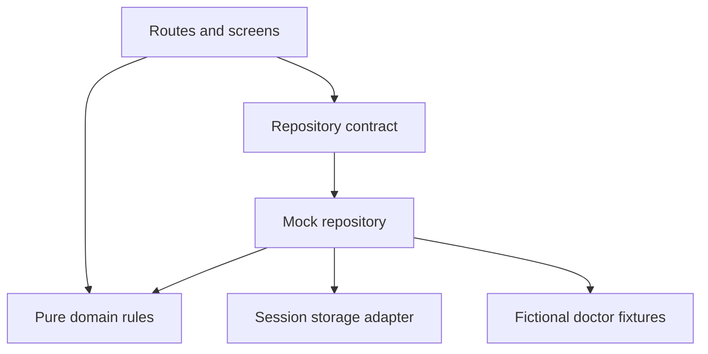

# MediConnect — complete project and source guide

This companion contains the complete source tree and the contents of every hand-authored key file. Download the ZIP for the ready-to-run directory, including the generated package-lock.json. No backend credentials are needed.

## Start here

```bash
cd mediconnect
npm ci
npm run dev
```

Use Node.js 24 LTS. Open http://localhost:5173. Run npm test and npm run build to verify.

## Complete source tree

```text
mediconnect/
  docs/
    REFERENCE_REVIEW.md
    VALIDATION.md
  src/
    app/
      App.test.tsx
      App.tsx
      RepositoryProvider.tsx
    config/
      catalog.ts
    data/
      contracts.ts
      doctors.ts
      mockRepository.test.ts
      mockRepository.ts
      storage.ts
    features/
      appointments/
        AppointmentsPage.tsx
        BookingPage.tsx
        booking.test.ts
        booking.ts
        model.ts
      doctors/
        DiscoveryPage.tsx
        DoctorCard.tsx
        ProfilePage.tsx
        model.ts
        search.test.ts
        search.ts
    shared/
      Avatar.tsx
      Status.tsx
      date.ts
      useAsync.ts
    main.tsx
    styles.css
    vite-env.d.ts
  .gitignore
  .nvmrc
  README.md
  index.html
  package-lock.json
  package.json
  tsconfig.json
  vite.config.ts
  SOURCE_GUIDE.md
```

Generated node_modules/ and dist/ are intentionally excluded from the source archive. The lockfile is included in the ZIP; its generated registry metadata is not expanded below. This guide does not recursively include itself.

## Architecture and source contents

### README.md

````markdown
# MediConnect

**Find a doctor. Understand your options. Choose a time.**

An original, runnable doctor-discovery and appointment web app inspired by the core patient journey in the supplied Practo clone. This is the frontend foundation for the MediConnect Spring Boot project discussed earlier. It uses fictional data and a mock repository; it does not implement the microservice backend yet.

## Run it

Use Node.js **24 LTS** and npm. No API keys, database, Google account, or payment provider is required.

```bash
npm ci
npm run dev
```

Open `http://localhost:5173`. Stop the development server with Ctrl+C.

```bash
npm test             # domain, persistence, and rendered user-flow tests
npm run typecheck    # strict TypeScript checks
npm run build        # typecheck + production build in dist/
npm run preview      # serve that build locally at http://localhost:4173
```

The archive includes a lockfile. Prefer `npm ci` for the checked dependency set. For a manually reconstructed copy without the lockfile, run `npm install` first.

## What works

- Search fictional doctors by name, specialty, clinic, or area.
- Combine location, specialty, and maximum-fee filters; sort by name, fee, or experience.
- Open a dedicated profile with qualifications, clinic, languages, fee, and appointment times.
- Select a 30-minute slot from the next seven days and confirm fictional patient details.
- Review confirmed and cancelled appointments; cancel with explicit confirmation.
- Reload the same tab without losing demo appointments.
- Recover from empty results, unavailable slots, invalid doctor links, and data-layer errors.
- Responsive layouts, native labelled controls, keyboard focus states, a skip link, and status messages.

All scheduling and display use **Asia/Kolkata** (IST), regardless of the visitor’s computer timezone. Slots start tomorrow to avoid misleading same-day availability. Every doctor follows one simple mock schedule; real per-doctor calendars are a backend concern.

Use the prefilled **Demo Patient / 9876543210** details. No contact messages or real bookings are sent. Do not enter real personal or health information.

## Stack and reasoning

| Choice                                | Reason                                                                                              |
| ------------------------------------- | --------------------------------------------------------------------------------------------------- |
| React 19                              | Reusable interactive screens, matching the React direction of your earlier interview preparation    |
| TypeScript 7, strict mode             | Explicit Doctor, Slot, Appointment, and repository contracts; catches mismatched data at build time |
| Vite 8                                | Small SPA setup, quick dev server, production bundling                                              |
| React Router 7                        | Separate discovery/profile/booking/history routes and URL-driven search state                       |
| React context + local component state | Context injects the repository; forms stay local; there is no unnecessary global Redux store        |
| CSS with shared design tokens         | Original cream/forest-green visual system, responsive grids, no copied branded assets or layout     |
| Native Intl and Date                  | Explicit clinic timezone without Moment or a date dependency                                        |
| Vitest 5 + Testing Library + jsdom    | Pure business-rule tests, adapter tests, and a rendered booking/cancellation journey                |
| sessionStorage mock adapter           | No credentialed backend; refresh persistence scoped to the tab’s demo session                       |

Dependencies are pinned/locked in package.json and package-lock.json. The UI’s own runtime has no third-party network calls, remote fonts, or external images. The dev tools may connect locally for hot module updates.

## Architecture: features first, dependency boundaries second



- `src/app/`: routes, shared page shell, and repository injection.
- `src/features/doctors/`: Doctor model, pure search logic, discovery and profile UI.
- `src/features/appointments/`: Slot/Appointment models, pure booking/cancellation rules, booking/history UI.
- `src/data/`: repository contract, doctor fixtures, storage adapter, and mock implementation.
- `src/config/`: specialty/location catalog and demo configuration. Selects and specialty tiles are generated from this catalog.
- `src/shared/`: date formatting, avatars, load/error UI, and the async loading hook.
- `src/main.tsx`: composition root; this is the only place that chooses the concrete mock adapter.

Screens never access sessionStorage directly or embed backend URLs. Domain functions do not depend on React, routing, or storage. The mock adapter validates a booking again at submission time and reports storage failures before the UI shows success.

Search uses `q`, `city`, `specialty`, `fee`, and `sort` query parameters so a filtered view is reloadable/shareable. Patient names and phone numbers are never placed in URLs. Form drafts belong to the booking screen. Confirmation is identified by an opaque appointment ID.

## Routes

| Route                          | Purpose                                                  |
| ------------------------------ | -------------------------------------------------------- |
| `/` or `/doctors`              | Discovery and filters                                    |
| `/doctors/:doctorId`           | Dedicated doctor profile and slots                       |
| `/book/:doctorId?slot=:slotId` | Patient details and confirmation                         |
| `/appointments`                | This demo session’s appointment history and cancellation |
| Any other route                | Useful not-found screen                                  |

Static hosts require an SPA fallback to `index.html` for deep links. Vite development and preview servers handle these routes locally. Run the app through a server; do not double-click index.html.

## Booking consistency and limits

`reserveSlot` validates the patient name, Indian mobile format, doctor/slot relationship, future time, and existing confirmed appointments. `cancelBooking` preserves history and releases the slot. Repository writes re-read the session immediately before checking/saving. The simultaneous-submission test proves that one of two duplicate submissions fails **within this mock JavaScript session**.

This is **not** distributed booking protection. Separate tabs, devices, or users have independent mock sessions. Browser storage is editable, unencrypted, and not a patient account. Session storage normally lasts for the tab session and may be restored by the browser. No JWT, RBAC, healthcare records, or real patient identity is claimed here. Storage errors are visible instead of silently replacing bookings with an empty list.

The Spring Boot Appointment service must enforce booking atomically in MySQL. Redis caches and client-side disabled buttons must not be the source of truth.

## Connecting this frontend to your MediConnect services later

Implement `HealthcareRepository` in a new `src/data/httpRepository.ts`, then change repository construction in `src/main.tsx`. Keep the mock adapter for tests and standalone demos. Adapt server DTOs at this boundary rather than teaching every component about service payloads.

Proposed gateway contracts (not implemented endpoints):

| Adapter operation | Future gateway API                          | Owning service                  |
| ----------------- | ------------------------------------------- | ------------------------------- |
| list/get doctors  | `GET /api/doctors`, `GET /api/doctors/{id}` | Doctor                          |
| list slots        | `GET /api/doctors/{id}/slots`               | Appointment owns slot inventory |
| book              | `POST /api/appointments`                    | Appointment                     |
| list appointments | `GET /api/appointments/me`                  | Appointment                     |
| cancel            | `POST /api/appointments/{id}/cancel`        | Appointment                     |

Booking requests should identify an authenticated patient and slot, not trust an arbitrary client-provided role or patient ID. The backend derives authoritative doctor/slot/fee values. Return `409` for a taken slot; the adapter turns that into a useful booking error. Use authenticated ownership checks for history and cancellation. Doctor profiles live in Doctor service, patient identity/profile in Patient/Auth, and slot/booking state in Appointment. Start with synchronous REST for these screens; add Kafka notifications independently after a booking commits.

Suggested full-project layout when backend work begins:

```text
mediconnect/
  frontend/                 # this starter, moved intact
  backend/
    discovery-server/
    api-gateway/
    auth-service/
    patient-service/
    doctor-service/
    appointment-service/
    notification-service/   # later phase
  infrastructure/
    compose.yaml
```

Those backend directories are a future plan, not empty modules shipped as if implemented. Keep the earlier build sequence: infrastructure/patient → discovery/gateway → auth/RBAC → doctor → appointment/concurrency → Kafka → Redis/resilience.

## Learning / implementation order inside this starter

1. Read `config/catalog.ts` and the typed models: agree on shared vocabulary.
2. Read and run the search tests: understand combined filters and deterministic sorting.
3. Read `booking.ts` and its tests: understand slot identity, timestamps, validation, and cancellation.
4. Read the repository interface and mock implementation: understand the data boundary.
5. Read `DiscoveryPage` and `ProfilePage`: connect URL state to data and navigation.
6. Read `BookingPage` and `AppointmentsPage`: follow submit → data write → confirmation → cancellation.
7. Replace the adapter only when the real backend contracts are ready.

See `docs/REFERENCE_REVIEW.md` for the review and side-by-side comparison. `SOURCE_GUIDE.md` contains the complete file tree and all hand-authored key-file contents.

## Validation performed

Production build and strict typechecking pass. Automated tests cover search, slot generation, booking validation, stale/duplicate submissions, cancellation, persistence failures, malformed storage, and a rendered end-to-end visitor journey using jsdom. This validates UI behavior in a simulated DOM; real-browser visual/device QA was not performed in this environment. Two React Router `use client` bundler warnings are informational for this client-only SPA and do not fail the build.

## Reference attribution

Studied, not copied:

- https://practo.netlify.app/
- https://github.com/SaravanakumarJN/Practo---Pentagon/tree/a35ec9f587056fa227ded2fcf1da8d600c3abf42
- Earlier backend reference: https://github.com/chrisblakely01/java-spring-microservices/tree/33aaf18b5b12c41e2390420f50b4bd53b1c5b9e4

All MediConnect source, seed descriptions, visual styling, and project organization were written for this starter. No reference branding, source code, images, or exact page layout is reproduced.
````

### docs/REFERENCE_REVIEW.md

````markdown
# Reference review and MediConnect design decisions

Reviewed the live deployment and repository on 13 October 2026. Source snapshot: [`a35ec9f`](https://github.com/SaravanakumarJN/Practo---Pentagon/tree/a35ec9f587056fa227ded2fcf1da8d600c3abf42).

## Live-site findings: observed versus inferred

| Screen/flow                      | Evidence and observation                                                                                                                                                                                         |
| -------------------------------- | ---------------------------------------------------------------------------------------------------------------------------------------------------------------------------------------------------------------- |
| Home `/`                         | Observed navigation for Doctors, Consult, Pharmacy, Diagnostics, Login; promotional image sections; health-concern tiles; in-clinic specialty cards; articles; app download/SMS field; large multi-column footer |
| Doctor discovery `/doctors`      | Observed an illustrated blue hero, a two-field location/search bar, and six specialty shortcuts; typed Dentist but no doctor suggestions appeared during inspection                                              |
| Login `/login`                   | Observed email/password fields and a Sign up button; Google sign-in was disabled during inspection                                                                                                               |
| Specialty results                | Implemented in source with doctor cards, recommendation percentage, consultation fee filters, and sorting; live success not verified                                                                             |
| Doctor detail and slots          | Implemented in source with a doctor card and expandable daily tabs/time groups; live success not verified                                                                                                        |
| Patient details and booking      | Implemented in source after private-route login, followed by a Stripe checkout step; no credentials entered or payment attempted                                                                                 |
| Appointment history/cancellation | Implemented in source; live authenticated flow not verified                                                                                                                                                      |

No geolocation permission was granted and no sign-in, payment, or real booking was performed. The lack of live search results is a session observation, not proof that the entire site is down. Source inspection establishes intended behavior but cannot prove external integrations still work.

The home screen’s pharmacy, articles, lab, and consultation labels do not establish complete working modules. We do not add these to MediConnect’s requested appointment/discovery scope.

## Existing project organization

```text
Practo---Pentagon/
  backend/
    package.json
    node_modules/           # dependencies checked into the source tree
    src/
      config/db.js
      controllers/          # Express routers and inline database logic
      models/               # Mongoose schemas
      index.js
      server.js
  practo_clone/
    package.json
    public/
    src/
      components/           # shared components plus page-scale components
      pages/
      redux/auth/
      redux/doctorSearch/
      routes/
      utilities/axios.js
      utils.js
```

Frontend: React 17 / Create React App (`react-scripts` 4), JavaScript, React Router 5, Redux 4 with a custom thunk middleware, Material UI 4, CSS Modules, Axios, Moment, Google Login, and Stripe Checkout. Backend: Express 4, Mongoose 5, MongoDB, dotenv, CORS, Stripe, UUID.

### How the pieces connect

`index.js` mounts routing and Redux. Routes select pages or page-sized components. Doctor query actions call an Express API and feed the Redux search reducer; specialty results also make their own calls. Axios helpers are split between `utilities/axios.js`, `utils.js`, and actions. Search needs geolocation coordinates before it submits doctor queries. The manual location geocoding path is incomplete in SearchBar.

Doctor profiles contain name, specialization, experience, city/area, clinic, fee, description, image, likes, and a geospatial location. The UI uses both a custom numeric `id` and MongoDB `_id`. The user model stores profile fields and a Google identifier. Bookings link doctor/user MongoDB IDs and store patient name/contact, a string time, and a boolean status.

The booking UI generates time buttons, fetches existing bookings, and filters them locally. Selection places doctor ID and a timestamp in a route. After payment, it submits the booking and navigates to appointment history. Cancellation patches the boolean status. This is one Express application with shared MongoDB models, not a microservice architecture.

### Source routes

| Frontend route                                        | Purpose                   |
| ----------------------------------------------------- | ------------------------- |
| `/`                                                   | Promotional landing page  |
| `/doctors`                                            | Location/query search     |
| `/doctors/:id/id`                                     | Individual doctor result  |
| `/doctors/:speciality/speciality/:lat/lat/:long/long` | Specialty results         |
| `/appointment/:doctors_id/:time`                      | Protected booking details |
| `/appointments`                                       | Protected booking history |
| `/login`                                              | Login screen              |

## What it does well

- The core patient journey is coherent: discover → compare → select time → confirm → review history.
- Doctor cards expose specialty, experience, location, fee, and a booking action.
- React components and CSS Modules give some separation and style scoping.
- The backend has distinct doctor, user, booking, and appointment routers and model files.
- Search actions cancel a previous request, reducing stale-result races.
- Loading/error state exists for Redux search; appointment cancellation asks for confirmation.
- `.http`-style concepts from the earlier Java reference and isolated service patterns remain useful for the future backend, while this clone is most useful for product-flow study.

## Weaknesses we deliberately address

| Area                | Source evidence                                                                                                                                                             | MediConnect decision                                                                         |
| ------------------- | --------------------------------------------------------------------------------------------------------------------------------------------------------------------------- | -------------------------------------------------------------------------------------------- |
| Organization        | Page-sized Bookingdetails and Landingpage live under components; data logic is spread among helpers, actions, and screens                                                   | Feature folders with domain files plus an injected repository boundary                       |
| Types/contracts     | JavaScript and loose Mongoose String/Array fields; mixed numeric/MongoDB doctor IDs                                                                                         | Explicit Doctor, Slot, Appointment types; one ID format per adapter                          |
| State               | Auth reducer writes localStorage; auth flags are persisted as client state                                                                                                  | No pretend authentication; URL search state, local form state, session-scoped mock history   |
| Search              | Requires coordinates; geocoding handler logs results; manual location add action is commented out                                                                           | Configuration-driven city dropdown with no permissions or API keys                           |
| Search safety       | Raw user query becomes RegExp in the backend                                                                                                                                | Literal token search in the mock; server implementation should validate and bound queries    |
| Sorting             | `.sort()` mutates the React state array during render                                                                                                                       | Pure search returns a new sorted array with stable name tie-breaking                         |
| Fee filter          | The 0–200 branch calls the helper without using its returned data                                                                                                           | One consistent filter predicate, verified with boundary tests                                |
| Effects             | DoctorResultPage and BookingCard use a useState initializer for fetching; Appointments effect depends on appointments then updates appointments                             | Explicit useEffect-based loading hook with stale-response cleanup and retry                  |
| Booking correctness | Backend `Bookings.create(req.body)` has no atomic doctor/time conflict check or unique active-slot constraint                                                               | Tested mock recheck; MySQL transaction/constraint belongs in the later Appointment service   |
| Booking navigation  | `bookSlot()` is not awaited before navigating in the payment callback                                                                                                       | Await completed storage operation before displaying confirmation                             |
| Cancellation        | Success snackbar opens before the cancellation promise resolves                                                                                                             | Show success only after the data operation succeeds                                          |
| Time                | String slicing, browser-local date handling, and arithmetic on HHMM-like values                                                                                             | Canonical ISO timestamps, explicit IST schedule, and native Intl display                     |
| Payment             | Route path appears mismatched; schema uses consulting_fee while charge reads price; charge completion/error handling is weak                                                | No payment integration in the requested demo                                                 |
| Authorization       | PrivateRoutes checks a browser flag; backend accepts client-provided Google profile/user IDs without demonstrated token-verification middleware or booking ownership checks | Clearly identified mock session now; verified JWT identity and backend ownership rules later |
| Errors              | Many routes lack validation and centralized error handling; frontend catches often log only                                                                                 | Visible load/error states, typed booking errors, controlled empty/not-found screens          |
| Deployment          | Hard-coded Heroku/API addresses and client configuration; backend node_modules committed                                                                                    | No remote runtime dependency; lockfile; ignored generated directories                        |
| Testing             | Backend test script is a placeholder; frontend scaffold test is not domain coverage                                                                                         | Search/booking/adapter tests plus a rendered visitor journey                                 |
| Responsiveness      | README explicitly limits support to tablets and larger screens                                                                                                              | Mobile and desktop CSS layouts, with physical device QA still to be done                     |

These findings are static observations; we did not execute the reference backend or attempt to exploit its security gaps. No credential-looking source values are reproduced in the new project.

## Original design direction

MediConnect places discovery directly on its main screen rather than beginning with promotional tiles for multiple unrelated products. The layout uses a cream/forest-green palette, an abstract care motif, compact specialty tiles, a filter rail, and a two-column doctor grid. Profiles and slot selection have their own screen; booking has a quiet two-column review/form layout. Mobile screens stack these sections. All wording, doctor fixtures, initials artwork, and CSS were written for this project.

The retained goals are discovery, informed choice, and appointment booking. Medical records, pharmacy, diagnostics, payment, video consultation, live geolocation, and social login are deliberately outside this starter’s scope.

## Relationship to the Java microservices reference

The earlier Java reference demonstrates patient CRUD, auth, gateway routing, a billing gRPC stub, and Kafka analytics. It does not provide Doctor/Appointment services, Eureka, Redis, or role/ownership enforcement. This frontend gives your MediConnect project a usable patient-facing journey while those backend services are built phase by phase. Its repository interface is the seam for that connection; it does not pretend the microservices already exist.

## Primary sources

- Live UI: https://practo.netlify.app/
- Repository snapshot: https://github.com/SaravanakumarJN/Practo---Pentagon/tree/a35ec9f587056fa227ded2fcf1da8d600c3abf42
- Routes: https://github.com/SaravanakumarJN/Practo---Pentagon/blob/a35ec9f587056fa227ded2fcf1da8d600c3abf42/practo_clone/src/routes/Routes.jsx
- Search: https://github.com/SaravanakumarJN/Practo---Pentagon/blob/a35ec9f587056fa227ded2fcf1da8d600c3abf42/practo_clone/src/components/searchBar/SearchBar.jsx
- Booking UI: https://github.com/SaravanakumarJN/Practo---Pentagon/blob/a35ec9f587056fa227ded2fcf1da8d600c3abf42/practo_clone/src/components/Bookingdetails.jsx
- Booking router: https://github.com/SaravanakumarJN/Practo---Pentagon/blob/a35ec9f587056fa227ded2fcf1da8d600c3abf42/backend/src/controllers/booking.controller.js
- React/TypeScript: https://react.dev/learn/typescript
- Vite: https://vite.dev/guide/
- Vitest: https://vitest.dev/guide/
````

### docs/VALIDATION.md

````markdown
# Validation

- `npm run build`: passed strict TypeScript checks and generated the production bundle.
- `npm test`: passed **18 tests across 4 files**.
- Tests cover literal search, combined filters, fee boundaries, sorting, no mutation, IST slot generation, year rollover, input validation, forged/mismatched/past slots, duplicate bookings, cancellation/rebooking, same-session simultaneous submissions, reload persistence through an adapter, unknown doctors, storage failures, corrupted persisted data, empty search, unavailable booking links, and a rendered full booking/cancellation journey.
- UI integration tests use jsdom and Testing Library. Real-browser layout/device QA was not performed; no pixel-level or physical-mobile verification is claimed.
- Reference live UI was separately inspected in a browser. Search suggestions did not appear during inspection; Google sign-in was disabled. Reference protected/payment flows were reviewed in source only.
- Informational React Router `use client` directive warnings do not affect this client-only build.
````

### .gitignore

````text
node_modules/
dist/
coverage/
.env
*.local
````

### .nvmrc

````text
24
````

### index.html

````html
<!doctype html>
<html lang="en">
  <head>
    <meta charset="UTF-8" />
    <meta name="viewport" content="width=device-width, initial-scale=1.0" />
    <meta name="theme-color" content="#0e5146" />
    <meta
      name="description"
      content="MediConnect — find a doctor and plan your next appointment. A fictional learning demo."
    />
    <title>MediConnect | Care, a little closer.</title>
  </head>
  <body>
    <div id="root"></div>
    <script type="module" src="/src/main.tsx"></script>
  </body>
</html>
````

### package.json

````json
{
  "name": "mediconnect",
  "version": "1.0.0",
  "private": true,
  "type": "module",
  "engines": {
    "node": ">=22.12.0"
  },
  "scripts": {
    "dev": "vite",
    "build": "tsc --noEmit && vite build",
    "preview": "vite preview",
    "test": "vitest run",
    "test:watch": "vitest",
    "typecheck": "tsc --noEmit"
  },
  "dependencies": {
    "react": "19.3.0",
    "react-dom": "19.3.0",
    "react-router-dom": "7.18.4"
  },
  "devDependencies": {
    "@testing-library/react": "16.3.3",
    "@testing-library/user-event": "14.6.8",
    "@types/react": "^19.0.0",
    "@types/react-dom": "^19.0.0",
    "jsdom": "30.1.2",
    "prettier": "3.9.10",
    "typescript": "7.0.2",
    "vite": "8.3.4",
    "vitest": "5.0.4"
  }
}
````

### src/app/App.test.tsx

````tsx
// @vitest-environment jsdom
import { afterEach, beforeEach, describe, expect, it, vi } from "vitest";
import { cleanup, render, screen } from "@testing-library/react";
import userEvent from "@testing-library/user-event";
import { MemoryRouter } from "react-router-dom";
import { App } from "./App";
import { RepositoryProvider } from "./RepositoryProvider";
import { createMockRepository } from "../data/mockRepository";
import { createMemoryStorage } from "../data/storage";

beforeEach(() => {
  window.scrollTo = vi.fn();
});
afterEach(cleanup);
function start(route: string) {
  const repository = createMockRepository(
    createMemoryStorage(),
    () => new Date("2026-10-13T13:00:00Z"),
    () => "demo-appointment",
  );
  render(
    <MemoryRouter initialEntries={[route]}>
      <RepositoryProvider repository={repository}>
        <App />
      </RepositoryProvider>
    </MemoryRouter>,
  );
  return { repository, user: userEvent.setup() };
}
describe("visitor journey", () => {
  it("finds a doctor, books a slot, sees confirmation, and cancels the appointment", async () => {
    const { repository, user } = start("/doctors?city=Rourkela");
    await user.click(
      await screen.findByRole("link", { name: "Dr. Ananya Sen" }),
    );
    await user.click(await screen.findByRole("link", { name: /^9:00/ }));
    await user.click(
      await screen.findByRole("button", { name: /Confirm demo appointment/ }),
    );
    expect(
      await screen.findByText("✓ Your demo appointment is confirmed."),
    ).toBeTruthy();
    expect((await repository.listAppointments())[0].status).toBe("confirmed");
    await user.click(
      screen.getByRole("button", { name: "Cancel appointment" }),
    );
    await user.click(screen.getByRole("button", { name: "Yes, cancel" }));
    expect(
      await screen.findByText(
        "Appointment cancelled. The slot is available again.",
      ),
    ).toBeTruthy();
    expect((await repository.listAppointments())[0].status).toBe("cancelled");
  });
  it("renders a useful empty search instead of disappearing content", async () => {
    start("/doctors?q=unfindable");
    expect(
      await screen.findByRole("heading", { name: "A wider search may help." }),
    ).toBeTruthy();
    expect(
      screen.getByRole("button", { name: "Show all doctors" }),
    ).toBeTruthy();
  });
  it("handles unknown profiles and unavailable booking links", async () => {
    start("/book/ananya?slot=forged");
    expect(
      await screen.findByRole("heading", {
        name: "This slot is no longer available.",
      }),
    ).toBeTruthy();
    expect(
      screen.getByRole("link", { name: "Choose another time" }),
    ).toBeTruthy();
  });
});
````

### src/app/App.tsx

````tsx
import { useEffect } from "react";
import {
  Link,
  NavLink,
  Outlet,
  Route,
  Routes,
  useLocation,
} from "react-router-dom";
import { DiscoveryPage } from "../features/doctors/DiscoveryPage";
import { ProfilePage } from "../features/doctors/ProfilePage";
import { BookingPage } from "../features/appointments/BookingPage";
import { AppointmentsPage } from "../features/appointments/AppointmentsPage";

function Layout() {
  const { pathname } = useLocation();
  useEffect(() => {
    window.scrollTo(0, 0);
  }, [pathname]);
  return (
    <>
      <a className="skip-link" href="#main">
        Skip to content
      </a>
      <header className="site-header">
        <Link className="brand" to="/">
          <span className="brand-mark" aria-hidden="true">
            ✚
          </span>
          MediConnect<span className="brand-dot">.</span>
        </Link>
        <nav aria-label="Main navigation">
          <NavLink to="/doctors">Find a doctor</NavLink>
          <NavLink to="/appointments">My appointments</NavLink>
        </nav>
        <span className="demo-badge">LEARNING DEMO</span>
      </header>
      <main id="main" tabIndex={-1}>
        <Outlet />
      </main>
      <footer className="site-footer">
        <Link className="brand" to="/">
          MediConnect<span className="brand-dot">.</span>
        </Link>
        <p>Care starts with a connection.</p>
        <span>Fictional doctors. Demo appointments. Built for learning.</span>
      </footer>
    </>
  );
}
export function App() {
  return (
    <Routes>
      <Route element={<Layout />}>
        <Route index element={<DiscoveryPage />} />
        <Route path="doctors" element={<DiscoveryPage />} />
        <Route path="doctors/:doctorId" element={<ProfilePage />} />
        <Route path="book/:doctorId" element={<BookingPage />} />
        <Route path="appointments" element={<AppointmentsPage />} />
        <Route
          path="*"
          element={
            <section className="page-section empty">
              <h1>Page not found</h1>
              <Link className="button" to="/">
                Back to MediConnect
              </Link>
            </section>
          }
        />
      </Route>
    </Routes>
  );
}
````

### src/app/RepositoryProvider.tsx

````tsx
import { createContext, useContext } from "react";
import type { ReactNode } from "react";
import type { HealthcareRepository } from "../data/contracts";

const RepositoryContext = createContext<HealthcareRepository | null>(null);
export function RepositoryProvider({
  repository,
  children,
}: {
  repository: HealthcareRepository;
  children: ReactNode;
}) {
  return (
    <RepositoryContext.Provider value={repository}>
      {children}
    </RepositoryContext.Provider>
  );
}
export function useRepository(): HealthcareRepository {
  const value = useContext(RepositoryContext);
  if (!value) throw new Error("RepositoryProvider is required.");
  return value;
}
````

### src/config/catalog.ts

````typescript
export const specialties = [
  {
    id: "general",
    label: "General physician",
    symbol: "✚",
    hint: "A good place to begin",
  },
  {
    id: "dental",
    label: "Dentist",
    symbol: "◇",
    hint: "Keep your smile healthy",
  },
  {
    id: "skin",
    label: "Dermatologist",
    symbol: "☀",
    hint: "Care for skin & hair",
  },
  {
    id: "pediatric",
    label: "Pediatrician",
    symbol: "✦",
    hint: "For your little ones",
  },
  {
    id: "gynecology",
    label: "Gynecologist",
    symbol: "◌",
    hint: "Care through every stage",
  },
  {
    id: "ent",
    label: "ENT specialist",
    symbol: "◎",
    hint: "Ear, nose & throat care",
  },
] as const;
export type SpecialtyId = (typeof specialties)[number]["id"];
export const locations = ["Rourkela", "Bengaluru", "Bhubaneswar"] as const;
export type City = (typeof locations)[number];
export const specialtyLabel = (id: SpecialtyId) =>
  specialties.find((s) => s.id === id)!.label;
export const clinicTimeZone = "Asia/Kolkata";
export const sessionStorageKey = "mediconnect.demo.appointments.v1";
````

### src/data/contracts.ts

````typescript
import type { Doctor } from "../features/doctors/model";
import type {
  Appointment,
  BookingInput,
  Slot,
} from "../features/appointments/model";

// A future HTTP adapter will implement this boundary against the Spring Boot gateway.
export interface HealthcareRepository {
  listDoctors(): Promise<Doctor[]>;
  getDoctor(id: string): Promise<Doctor | undefined>;
  listSlots(doctorId: string): Promise<Slot[]>;
  listAppointments(): Promise<Appointment[]>;
  book(input: BookingInput): Promise<Appointment>;
  cancel(id: string): Promise<void>;
}
export interface AppointmentStorage {
  read(): Appointment[];
  write(appointments: Appointment[]): void;
}
````

### src/data/doctors.ts

````typescript
import type { Doctor } from "../features/doctors/model";

// Every person and clinic below is fictional. No claims of verification or real reviews.
export const doctors: Doctor[] = [
  {
    id: "ananya",
    name: "Dr. Ananya Sen",
    specialty: "general",
    city: "Rourkela",
    area: "Civil Township",
    clinic: "Willow Family Clinic",
    qualifications: "MBBS, MD — General Medicine",
    experienceYears: 12,
    feeInRupees: 500,
    languages: ["English", "Hindi", "Odia"],
    initials: "AS",
    color: "sage",
    about:
      "A general physician focused on everyday health concerns, preventive care, and helping patients understand their next steps.",
  },
  {
    id: "rohan",
    name: "Dr. Rohan Mehta",
    specialty: "dental",
    city: "Rourkela",
    area: "Chhend Colony",
    clinic: "Gentle Dental Studio",
    qualifications: "BDS, MDS — Conservative Dentistry",
    experienceYears: 9,
    feeInRupees: 400,
    languages: ["English", "Hindi"],
    initials: "RM",
    color: "sand",
    about:
      "Provides routine dental consultations and restorative dental care, with time set aside to explain treatment choices.",
  },
  {
    id: "ishita",
    name: "Dr. Ishita Rao",
    specialty: "skin",
    city: "Bengaluru",
    area: "Whitefield",
    clinic: "Bloom Skin Clinic",
    qualifications: "MBBS, MD — Dermatology",
    experienceYears: 11,
    feeInRupees: 800,
    languages: ["English", "Hindi", "Kannada"],
    initials: "IR",
    color: "rose",
    about:
      "Consultations for skin and hair concerns, with a focus on clear explanations and practical follow-up plans.",
  },
  {
    id: "neel",
    name: "Dr. Neel Das",
    specialty: "pediatric",
    city: "Bhubaneswar",
    area: "Patia",
    clinic: "Little Leaf Clinic",
    qualifications: "MBBS, MD — Pediatrics",
    experienceYears: 14,
    feeInRupees: 600,
    languages: ["English", "Hindi", "Odia"],
    initials: "ND",
    color: "sky",
    about:
      "Helps families navigate childhood health concerns and routine growth and development consultations.",
  },
  {
    id: "mira",
    name: "Dr. Mira Kapoor",
    specialty: "gynecology",
    city: "Bengaluru",
    area: "Indiranagar",
    clinic: "Fern Women’s Clinic",
    qualifications: "MBBS, MS — Obstetrics & Gynecology",
    experienceYears: 16,
    feeInRupees: 900,
    languages: ["English", "Hindi"],
    initials: "MK",
    color: "sage",
    about:
      "Offers consultations for women’s health across life stages, with space for questions and shared planning.",
  },
  {
    id: "arjun",
    name: "Dr. Arjun Patnaik",
    specialty: "ent",
    city: "Rourkela",
    area: "Sector 19",
    clinic: "Clearway ENT Clinic",
    qualifications: "MBBS, MS — ENT",
    experienceYears: 10,
    feeInRupees: 550,
    languages: ["English", "Hindi", "Odia"],
    initials: "AP",
    color: "sky",
    about:
      "Consultations for ear, nose, and throat concerns, including ongoing symptoms and routine follow-up visits.",
  },
  {
    id: "tara",
    name: "Dr. Tara Nair",
    specialty: "general",
    city: "Bengaluru",
    area: "Marathahalli",
    clinic: "Everyday Care Clinic",
    qualifications: "MBBS, MD — General Medicine",
    experienceYears: 8,
    feeInRupees: 650,
    languages: ["English", "Hindi", "Malayalam"],
    initials: "TN",
    color: "sand",
    about:
      "Supports everyday healthcare needs and preventive consultations, with a straightforward approach to care.",
  },
  {
    id: "dev",
    name: "Dr. Dev Mishra",
    specialty: "dental",
    city: "Bhubaneswar",
    area: "Saheed Nagar",
    clinic: "Oak Dental Clinic",
    qualifications: "BDS, MDS — Prosthodontics",
    experienceYears: 13,
    feeInRupees: 450,
    languages: ["English", "Hindi", "Odia"],
    initials: "DM",
    color: "rose",
    about:
      "Provides dental consultations for routine care and restorative needs, with clear discussion of available options.",
  },
];
````

### src/data/mockRepository.test.ts

````typescript
import { describe, expect, it } from "vitest";
import { createMockRepository } from "./mockRepository";
import { createMemoryStorage, createSessionStorage } from "./storage";
import { sessionStorageKey } from "../config/catalog";

describe("repository boundary", () => {
  it("rejects one of two simultaneous submissions in the same repository session", async () => {
    const repository = createMockRepository(
      createMemoryStorage(),
      () => new Date("2026-10-13T13:00:00Z"),
      () => "test-id",
    );
    const slots = await repository.listSlots("ananya");
    const input = {
      doctorId: "ananya",
      slotId: slots[0].id,
      patientName: "Demo Patient",
      phone: "9876543210",
    };
    const results = await Promise.allSettled([
      repository.book(input),
      repository.book(input),
    ]);
    expect(
      results.filter((result) => result.status === "fulfilled"),
    ).toHaveLength(1);
    expect(
      results.filter((result) => result.status === "rejected"),
    ).toHaveLength(1);
    expect(await repository.listSlots("ananya")).toHaveLength(41);
    await repository.cancel("test-id");
    expect(await repository.listSlots("ananya")).toHaveLength(42);
  });
  it("preserves stored appointments when a repository instance is recreated", async () => {
    const storage = createMemoryStorage();
    const clock = () => new Date("2026-10-13T13:00:00Z");
    const first = createMockRepository(storage, clock, () => "test-id");
    const slot = (await first.listSlots("rohan"))[0];
    await first.book({
      doctorId: "rohan",
      slotId: slot.id,
      patientName: "Demo Patient",
      phone: "9876543210",
    });
    expect(
      await createMockRepository(storage, clock).listAppointments(),
    ).toHaveLength(1);
  });
  it("rejects unknown doctors and storage failures", async () => {
    const repository = createMockRepository(
      {
        read: () => [],
        write: () => {
          throw new Error("Storage unavailable");
        },
      },
      () => new Date("2026-10-13T13:00:00Z"),
    );
    await expect(repository.listSlots("missing")).rejects.toThrow(
      "Doctor not found",
    );
    const slot = (await repository.listSlots("ananya"))[0];
    await expect(
      repository.book({
        doctorId: "ananya",
        slotId: slot.id,
        patientName: "Demo Patient",
        phone: "9876543210",
      }),
    ).rejects.toThrow("Storage unavailable");
  });
  it("fails visibly instead of silently discarding malformed persisted data", () => {
    const values = new Map<string, string>();
    const storage: Storage = {
      getItem: (key) => values.get(key) || null,
      setItem: (key, value) => {
        values.set(key, value);
      },
      removeItem: (key) => {
        values.delete(key);
      },
      clear: () => values.clear(),
      key: (index) => [...values.keys()][index] || null,
      get length() {
        return values.size;
      },
    };
    const adapter = createSessionStorage(storage);
    expect(adapter.read()).toEqual([]);
    storage.setItem(sessionStorageKey, "{broken");
    expect(() => adapter.read()).toThrow("damaged");
    storage.setItem(sessionStorageKey, '[{"id":"wrong"}]');
    expect(() => adapter.read()).toThrow("unsupported");
  });
});
````

### src/data/mockRepository.ts

````typescript
import { doctors } from "./doctors";
import type { AppointmentStorage, HealthcareRepository } from "./contracts";
import {
  cancelBooking,
  createSlots,
  reserveSlot,
} from "../features/appointments/booking";
import { BookingError } from "../features/appointments/model";

export function createMockRepository(
  storage: AppointmentStorage,
  clock = () => new Date(),
  nextId: () => string = () => crypto.randomUUID(),
): HealthcareRepository {
  const delay = () => new Promise((resolve) => setTimeout(resolve, 100));
  const requireDoctor = (id: string) => {
    if (!doctors.some((doctor) => doctor.id === id))
      throw new BookingError("NOT_FOUND", "Doctor not found.");
  };
  return {
    async listDoctors() {
      await delay();
      return structuredClone(doctors);
    },
    async getDoctor(id) {
      await delay();
      return structuredClone(doctors.find((doctor) => doctor.id === id));
    },
    async listSlots(doctorId) {
      await delay();
      requireDoctor(doctorId);
      const booked = storage
        .read()
        .filter((item) => item.status === "confirmed");
      return createSlots(doctorId, clock()).filter(
        (slot) =>
          !booked.some(
            (item) =>
              item.doctorId === doctorId && item.startsAt === slot.startsAt,
          ),
      );
    },
    async listAppointments() {
      await delay();
      return storage
        .read()
        .sort((a, b) => a.startsAt.localeCompare(b.startsAt));
    },
    async book(input) {
      await delay();
      requireDoctor(input.doctorId);
      // Re-read immediately before the synchronous check/write: catches stale UI in this tab.
      const current = storage.read();
      const now = clock();
      const appointment = reserveSlot(
        input,
        createSlots(input.doctorId, now),
        current,
        nextId(),
        now,
      );
      storage.write([...current, appointment]);
      return appointment;
    },
    async cancel(id) {
      await delay();
      storage.write(cancelBooking(storage.read(), id));
    },
  };
}
````

### src/data/storage.ts

````typescript
import { sessionStorageKey } from "../config/catalog";
import type { Appointment } from "../features/appointments/model";
import type { AppointmentStorage } from "./contracts";

function isAppointment(value: unknown): value is Appointment {
  if (typeof value !== "object" || value === null) return false;
  const a = value as Record<string, unknown>;
  return (
    [
      "id",
      "doctorId",
      "slotId",
      "patientName",
      "phone",
      "startsAt",
      "endsAt",
      "createdAt",
    ].every((key) => typeof a[key] === "string") &&
    ["confirmed", "cancelled"].includes(String(a.status)) &&
    ["startsAt", "endsAt", "createdAt"].every((key) =>
      Number.isFinite(Date.parse(String(a[key]))),
    )
  );
}

export function createSessionStorage(storage: Storage): AppointmentStorage {
  return {
    read() {
      const raw = storage.getItem(sessionStorageKey);
      if (!raw) return [];
      let parsed: unknown;
      try {
        parsed = JSON.parse(raw);
      } catch {
        throw new Error(
          "Demo appointment data is damaged. Clear this tab’s session storage to reset it.",
        );
      }
      if (!Array.isArray(parsed) || !parsed.every(isAppointment))
        throw new Error("Demo appointment data has an unsupported format.");
      return parsed;
    },
    write(appointments) {
      storage.setItem(sessionStorageKey, JSON.stringify(appointments));
    },
  };
}

export function createMemoryStorage(): AppointmentStorage {
  let values: Appointment[] = [];
  return {
    read: () => values.map((item) => ({ ...item })),
    write: (items) => {
      values = items.map((item) => ({ ...item }));
    },
  };
}
````

### src/features/appointments/AppointmentsPage.tsx

````tsx
import { useCallback, useState } from "react";
import { Link, useSearchParams } from "react-router-dom";
import { useRepository } from "../../app/RepositoryProvider";
import { useAsync } from "../../shared/useAsync";
import { Status } from "../../shared/Status";
import { formatDate, formatTime } from "../../shared/date";
import { Avatar } from "../../shared/Avatar";

export function AppointmentsPage() {
  const repository = useRepository();
  const [params] = useSearchParams();
  const confirmed = params.get("confirmed");
  const load = useCallback(
    async () => ({
      appointments: await repository.listAppointments(),
      doctors: await repository.listDoctors(),
    }),
    [repository],
  );
  const state = useAsync(load);
  const [pendingCancel, setPendingCancel] = useState("");
  const [busy, setBusy] = useState("");
  const [error, setError] = useState("");
  const [notice, setNotice] = useState("");
  async function cancel(id: string) {
    setBusy(id);
    setError("");
    try {
      await repository.cancel(id);
      setPendingCancel("");
      setNotice("Appointment cancelled. The slot is available again.");
      state.refresh();
    } catch (reason) {
      setError(reason instanceof Error ? reason.message : "Could not cancel.");
    } finally {
      setBusy("");
    }
  }
  return (
    <section className="page-section">
      <div className="page-title">
        <span className="eyebrow">YOUR CARE, PLANNED</span>
        <h1>My appointments</h1>
        <p>A little less to keep in your head.</p>
      </div>
      {state.data?.appointments.some(
        (a) => a.id === confirmed && a.status === "confirmed",
      ) && (
        <div className="success" role="status">
          <strong>✓ Your demo appointment is confirmed.</strong>
          <p>You can review it below. No real clinic has been contacted.</p>
        </div>
      )}
      {notice && (
        <p className="success" role="status">
          {notice}
        </p>
      )}
      {error && (
        <p className="error" role="alert">
          {error}
        </p>
      )}
      <Status
        loading={state.loading}
        error={state.error}
        retry={state.refresh}
      />
      {!state.loading && !state.error && (
        <div className="appointment-list">
          {!state.data?.appointments.length && (
            <div className="empty">
              <h2>Your next visit starts here.</h2>
              <p>Find a doctor and choose an appointment time.</p>
              <Link className="button" to="/doctors">
                Explore doctors ↗
              </Link>
            </div>
          )}
          {state.data?.appointments.map((appointment) => {
            const doctor = state.data?.doctors.find(
              (item) => item.id === appointment.doctorId,
            );
            return (
              <article className="appointment-card" key={appointment.id}>
                {doctor && <Avatar doctor={doctor} />}
                <div className="appointment-info">
                  <span className={`badge ${appointment.status}`}>
                    {appointment.status}
                  </span>
                  <h2>{doctor?.name || "Doctor unavailable"}</h2>
                  <p>
                    {doctor?.clinic} · {doctor?.city}
                  </p>
                  <strong>
                    {formatDate(appointment.startsAt)} ·{" "}
                    {formatTime(appointment.startsAt)} IST
                  </strong>
                  <p>
                    For {appointment.patientName} · Reference{" "}
                    {appointment.id.slice(0, 8)}
                  </p>
                </div>
                {appointment.status === "confirmed" && (
                  <div className="cancel-actions">
                    {pendingCancel === appointment.id ? (
                      <>
                        <p>Cancel this demo appointment?</p>
                        <button
                          className="button danger"
                          disabled={busy === appointment.id}
                          onClick={() => void cancel(appointment.id)}
                        >
                          {busy ? "Cancelling…" : "Yes, cancel"}
                        </button>
                        <button
                          className="text-link"
                          disabled={Boolean(busy)}
                          onClick={() => setPendingCancel("")}
                        >
                          Keep appointment
                        </button>
                      </>
                    ) : (
                      <button
                        className="button secondary"
                        onClick={() => setPendingCancel(appointment.id)}
                      >
                        Cancel appointment
                      </button>
                    )}
                  </div>
                )}
              </article>
            );
          })}
        </div>
      )}
      <p className="muted">
        Demo appointments belong to this tab’s session. They are not a real
        patient account.
      </p>
    </section>
  );
}
````

### src/features/appointments/BookingPage.tsx

````tsx
import { useCallback, useState } from "react";
import type { FormEvent } from "react";
import {
  Link,
  useNavigate,
  useParams,
  useSearchParams,
} from "react-router-dom";
import { useRepository } from "../../app/RepositoryProvider";
import { useAsync } from "../../shared/useAsync";
import { Status } from "../../shared/Status";
import { Avatar } from "../../shared/Avatar";
import { formatDate, formatFee, formatTime } from "../../shared/date";
import { specialtyLabel } from "../../config/catalog";

export function BookingPage() {
  const { doctorId = "" } = useParams();
  const [params] = useSearchParams();
  const slotId = params.get("slot") || "";
  const repository = useRepository();
  const navigate = useNavigate();
  const load = useCallback(async () => {
    const doctor = await repository.getDoctor(doctorId);
    const slots = doctor ? await repository.listSlots(doctorId) : [];
    return { doctor, slot: slots.find((slot) => slot.id === slotId) };
  }, [repository, doctorId, slotId]);
  const state = useAsync(load);
  const [patientName, setPatientName] = useState("Demo Patient");
  const [phone, setPhone] = useState("9876543210");
  const [error, setError] = useState("");
  const [submitting, setSubmitting] = useState(false);
  const doctor = state.data?.doctor;
  const slot = state.data?.slot;
  async function submit(event: FormEvent<HTMLFormElement>) {
    event.preventDefault();
    if (!doctor || !slot || submitting) return;
    setSubmitting(true);
    setError("");
    try {
      const booking = await repository.book({
        doctorId,
        slotId,
        patientName,
        phone,
      });
      navigate(`/appointments?confirmed=${encodeURIComponent(booking.id)}`, {
        replace: true,
      });
    } catch (reason) {
      setError(
        reason instanceof Error
          ? reason.message
          : "Could not book. Please try again.",
      );
    } finally {
      setSubmitting(false);
    }
  }
  return (
    <section className="page-section">
      <Link className="text-link" to={`/doctors/${doctorId}`}>
        ← Change date or time
      </Link>
      <div className="page-title">
        <span className="eyebrow">ONE LAST STEP</span>
        <h1>Make room for your health.</h1>
        <p>Review your visit and confirm the details.</p>
      </div>
      <Status
        loading={state.loading}
        error={state.error}
        retry={state.refresh}
      />
      {!state.loading &&
        !state.error &&
        (doctor && slot ? (
          <div className="checkout-grid">
            <article className="visit-summary">
              <div className="doctor-top">
                <Avatar doctor={doctor} />
                <div>
                  <span className="eyebrow">
                    {specialtyLabel(doctor.specialty)}
                  </span>
                  <h2>{doctor.name}</h2>
                  <p>{doctor.clinic}</p>
                </div>
              </div>
              <dl>
                <div>
                  <dt>Date</dt>
                  <dd>{formatDate(slot.startsAt)}</dd>
                </div>
                <div>
                  <dt>Time</dt>
                  <dd>{formatTime(slot.startsAt)} IST</dd>
                </div>
                <div>
                  <dt>Location</dt>
                  <dd>
                    {doctor.area}, {doctor.city}
                  </dd>
                </div>
                <div>
                  <dt>Consultation fee</dt>
                  <dd>{formatFee(doctor.feeInRupees)}</dd>
                </div>
              </dl>
              <p className="booking-note">
                No payment or real appointment is made. This confirmation is
                saved only in this browser tab’s demo session.
              </p>
            </article>
            <form className="patient-form" onSubmit={submit}>
              <h2>Patient details</h2>
              <p>Use the sample details below or enter fictional details.</p>
              <label>
                Patient name
                <input
                  name="patientName"
                  autoComplete="off"
                  required
                  minLength={2}
                  maxLength={80}
                  value={patientName}
                  onChange={(e) => setPatientName(e.target.value)}
                />
              </label>
              <label>
                Mobile number
                <input
                  name="phone"
                  type="tel"
                  inputMode="numeric"
                  autoComplete="off"
                  required
                  pattern="[6-9][0-9]{9}"
                  maxLength={10}
                  value={phone}
                  onChange={(e) => setPhone(e.target.value)}
                  aria-describedby="phone-help"
                />
              </label>
              <small id="phone-help">
                10-digit Indian mobile format. No messages are sent.
              </small>
              {error && (
                <p className="error" role="alert">
                  {error}
                </p>
              )}
              <button className="button full" disabled={submitting}>
                {submitting ? "Confirming…" : "Confirm demo appointment →"}
              </button>
              <p className="muted">
                Please do not enter real health or contact information.
              </p>
            </form>
          </div>
        ) : (
          <div className="empty">
            <h2>This slot is no longer available.</h2>
            <p>It may have been booked or the link may be invalid.</p>
            <Link className="button" to={`/doctors/${doctorId}`}>
              Choose another time
            </Link>
          </div>
        ))}
    </section>
  );
}
````

### src/features/appointments/booking.test.ts

````typescript
import { describe, expect, it } from "vitest";
import { createSlots, reserveSlot, cancelBooking } from "./booking";
import { clinicDateKey } from "../../shared/date";
import type { BookingInput } from "./model";

const now = new Date("2026-10-13T13:00:00Z");
const slots = createSlots("ananya", now);
const input: BookingInput = {
  doctorId: "ananya",
  slotId: slots[0].id,
  patientName: " Demo Patient ",
  phone: "9876543210",
};
describe("booking rules", () => {
  it("generates 7 days of 30-minute slots in clinic time, crossing year boundaries", () => {
    expect(slots).toHaveLength(42);
    expect(slots[0].startsAt).toBe("2026-10-14T03:30:00.000Z");
    expect(Date.parse(slots[0].endsAt) - Date.parse(slots[0].startsAt)).toBe(
      1_800_000,
    );
    expect(clinicDateKey(new Date("2026-12-31T20:00:00Z"))).toBe("2027-01-01");
    expect(
      createSlots("ananya", new Date("2026-12-31T13:00:00Z"))[0].id,
    ).toContain("2027-01-01");
  });
  it("trims details and confirms a valid appointment", () => {
    expect(reserveSlot(input, slots, [], "a1", now)).toMatchObject({
      id: "a1",
      patientName: "Demo Patient",
      status: "confirmed",
    });
  });
  it("rejects invalid patient details", () => {
    expect(() =>
      reserveSlot({ ...input, patientName: " " }, slots, [], "a1", now),
    ).toThrow("Enter a name");
    expect(() =>
      reserveSlot({ ...input, phone: "12345" }, slots, [], "a1", now),
    ).toThrow("mobile");
  });
  it("rejects forged, mismatched, and past slots", () => {
    expect(() =>
      reserveSlot({ ...input, slotId: "forged" }, slots, [], "a1", now),
    ).toThrow("not offered");
    expect(() =>
      reserveSlot({ ...input, doctorId: "rohan" }, slots, [], "a1", now),
    ).toThrow("not offered");
    expect(() =>
      reserveSlot(input, slots, [], "a1", new Date(slots[0].startsAt)),
    ).toThrow("already passed");
  });
  it("rejects duplicate active appointments without changing existing data", () => {
    const first = reserveSlot(input, slots, [], "a1", now);
    const current = [first];
    expect(() => reserveSlot(input, slots, current, "a2", now)).toThrow(
      "just been booked",
    );
    expect(current).toEqual([first]);
  });
  it("releases a cancelled slot, preserves history, and makes cancellation idempotent", () => {
    const first = reserveSlot(input, slots, [], "a1", now);
    const cancelled = cancelBooking([first], "a1");
    expect(cancelled[0].status).toBe("cancelled");
    expect(first.status).toBe("confirmed");
    expect(reserveSlot(input, slots, cancelled, "a2", now).status).toBe(
      "confirmed",
    );
    expect(cancelBooking(cancelled, "a1")).toEqual(cancelled);
    expect(() => cancelBooking(cancelled, "missing")).toThrow("not found");
  });
});
````

### src/features/appointments/booking.ts

````typescript
import { clinicDateKey } from "../../shared/date";
import { BookingError } from "./model";
import type { Appointment, BookingInput, Slot } from "./model";

// Clinic schedule uses explicit +05:30 offsets; it never depends on the browser timezone.
export function createSlots(
  doctorId: string,
  now = new Date(),
  days = 7,
): Slot[] {
  const result: Slot[] = [];
  const midnight = new Date(`${clinicDateKey(now)}T00:00:00+05:30`);
  for (let day = 1; day <= days; day++) {
    const dateKey = clinicDateKey(
      new Date(midnight.getTime() + day * 86_400_000),
    );
    for (const time of ["09:00", "09:30", "10:00", "11:00", "14:00", "15:30"]) {
      const start = new Date(`${dateKey}T${time}:00+05:30`);
      result.push({
        id: `${doctorId}:${dateKey}:${time}`,
        doctorId,
        startsAt: start.toISOString(),
        endsAt: new Date(start.getTime() + 30 * 60_000).toISOString(),
      });
    }
  }
  return result;
}

export function reserveSlot(
  input: BookingInput,
  slots: readonly Slot[],
  appointments: readonly Appointment[],
  id: string,
  now = new Date(),
): Appointment {
  const patientName = input.patientName.trim();
  const phone = input.phone.trim();
  if (
    patientName.length < 2 ||
    patientName.length > 80 ||
    !/^[6-9]\d{9}$/.test(phone)
  ) {
    throw new BookingError(
      "INVALID_DETAILS",
      "Enter a name (2–80 characters) and a valid 10-digit Indian mobile number.",
    );
  }
  const slot = slots.find(
    (item) => item.id === input.slotId && item.doctorId === input.doctorId,
  );
  if (!slot)
    throw new BookingError(
      "INVALID_SLOT",
      "This slot is not offered by this doctor. Please choose another.",
    );
  if (new Date(slot.startsAt).getTime() <= now.getTime())
    throw new BookingError(
      "PAST_SLOT",
      "This appointment time has already passed.",
    );
  if (
    appointments.some(
      (item) =>
        item.doctorId === slot.doctorId &&
        item.startsAt === slot.startsAt &&
        item.status === "confirmed",
    )
  ) {
    throw new BookingError(
      "SLOT_TAKEN",
      "That time has just been booked. Please choose another slot.",
    );
  }
  return {
    ...input,
    patientName,
    phone,
    id,
    startsAt: slot.startsAt,
    endsAt: slot.endsAt,
    status: "confirmed",
    createdAt: now.toISOString(),
  };
}

export function cancelBooking(
  appointments: readonly Appointment[],
  id: string,
): Appointment[] {
  if (!appointments.some((item) => item.id === id))
    throw new BookingError("NOT_FOUND", "Appointment not found.");
  return appointments.map((item) =>
    item.id === id ? { ...item, status: "cancelled" } : item,
  );
}
````

### src/features/appointments/model.ts

````typescript
export interface Slot {
  id: string;
  doctorId: string;
  startsAt: string;
  endsAt: string;
}
export interface BookingInput {
  doctorId: string;
  slotId: string;
  patientName: string;
  phone: string;
}
export interface Appointment extends BookingInput {
  id: string;
  startsAt: string;
  endsAt: string;
  status: "confirmed" | "cancelled";
  createdAt: string;
}
export class BookingError extends Error {
  constructor(
    public readonly code:
      | "INVALID_DETAILS"
      | "INVALID_SLOT"
      | "PAST_SLOT"
      | "SLOT_TAKEN"
      | "NOT_FOUND",
    message: string,
  ) {
    super(message);
    this.name = "BookingError";
  }
}
````

### src/features/doctors/DiscoveryPage.tsx

````tsx
import { useCallback } from "react";
import { useSearchParams } from "react-router-dom";
import { locations, specialties } from "../../config/catalog";
import { useRepository } from "../../app/RepositoryProvider";
import { useAsync } from "../../shared/useAsync";
import { Status } from "../../shared/Status";
import { DoctorCard } from "./DoctorCard";
import { searchDoctors } from "./search";
import type { DoctorSort } from "./model";

export function DiscoveryPage() {
  const repository = useRepository();
  const load = useCallback(() => repository.listDoctors(), [repository]);
  const state = useAsync(load);
  const [params, setParams] = useSearchParams();
  const query = params.get("q") || "";
  const city = params.get("city") || "";
  const specialty = params.get("specialty") || "";
  const rawSort = params.get("sort");
  const sort: DoctorSort =
    rawSort === "fee" || rawSort === "experience" ? rawSort : "name";
  const fee = Number(params.get("fee"));
  const maxFee =
    params.has("fee") && Number.isFinite(fee) && fee >= 0 ? fee : undefined;
  const results = searchDoctors(state.data || [], {
    query,
    city,
    specialty,
    sort,
    maxFee,
  });
  const change = (key: string, value: string) =>
    setParams(
      (previous) => {
        const next = new URLSearchParams(previous);
        if (value) next.set(key, value);
        else next.delete(key);
        return next;
      },
      { replace: true },
    );
  return (
    <>
      <section className="hero">
        <div className="hero-copy">
          <span className="eyebrow">YOUR NEXT STEP TO FEELING BETTER</span>
          <h1>
            Good care.
            <br />A little <em>closer.</em>
          </h1>
          <p>
            Find a doctor who fits your needs.
            <br />
            Choose a time that fits your day.
          </p>
          <a className="text-link" href="#results">
            Explore doctors <span aria-hidden="true">↓</span>
          </a>
        </div>
        <div className="hero-art" aria-hidden="true">
          <div className="orbit" />
          <div className="care-cross">✚</div>
          <div className="art-card">
            <span className="tiny-dot" />A simpler way to plan your care.
            <small>DISCOVER · CHOOSE · BOOK</small>
          </div>
          <span className="art-caption">Care starts with a connection.</span>
        </div>
      </section>
      <section className="search-panel" aria-label="Doctor search">
        <label>
          <span>YOUR LOCATION</span>
          <select
            aria-label="City"
            value={city}
            onChange={(e) => change("city", e.target.value)}
          >
            <option value="">All locations</option>
            {locations.map((item) => (
              <option key={item}>{item}</option>
            ))}
            {city && !(locations as readonly string[]).includes(city) && (
              <option value={city}>{city}</option>
            )}
          </select>
        </label>
        <label className="search-input">
          <span>WHO ARE YOU LOOKING FOR?</span>
          <input
            aria-label="Search doctors or clinics"
            placeholder="Doctor, specialty, or clinic"
            value={query}
            onChange={(e) => change("q", e.target.value)}
          />
        </label>
        <a className="button" href="#results">
          Find care <span aria-hidden="true">↗</span>
        </a>
      </section>
      <section className="specialties">
        <div className="section-label">
          <h2>Care for every day</h2>
          <p>Start with a specialty</p>
        </div>
        <div className="specialty-grid">
          {specialties.map((item) => (
            <button
              className={`specialty-tile ${specialty === item.id ? "selected" : ""}`}
              aria-pressed={specialty === item.id}
              key={item.id}
              onClick={() =>
                change("specialty", specialty === item.id ? "" : item.id)
              }
            >
              <span className="specialty-symbol" aria-hidden="true">
                {item.symbol}
              </span>
              <strong>{item.label}</strong>
              <small>{item.hint}</small>
            </button>
          ))}
        </div>
      </section>
      <section id="results" className="discovery">
        <aside className="filters">
          <span className="eyebrow">MAKE IT YOURS</span>
          <h2>Find your fit</h2>
          <label>
            Specialty
            <select
              value={specialty}
              onChange={(e) => change("specialty", e.target.value)}
            >
              <option value="">All specialties</option>
              {specialties.map((s) => (
                <option key={s.id} value={s.id}>
                  {s.label}
                </option>
              ))}
              {specialty && !specialties.some((s) => s.id === specialty) && (
                <option value={specialty}>{specialty}</option>
              )}
            </select>
          </label>
          <label>
            Consultation fee
            <select
              value={maxFee === undefined ? "" : String(maxFee)}
              onChange={(e) => change("fee", e.target.value)}
            >
              <option value="">Any fee</option>
              <option value="500">Up to ₹500</option>
              <option value="700">Up to ₹700</option>
              <option value="1000">Up to ₹1,000</option>
              {maxFee !== undefined && ![500, 700, 1000].includes(maxFee) && (
                <option value={maxFee}>Up to ₹{maxFee}</option>
              )}
            </select>
          </label>
          <button className="text-link" onClick={() => setParams({})}>
            Reset filters ↺
          </button>
          <div className="aside-note">
            <span aria-hidden="true">✦</span>
            <p>
              Take your time.
              <br />
              The right fit matters.
            </p>
          </div>
        </aside>
        <div className="results">
          <div className="results-heading">
            <div>
              <span className="eyebrow">A CONNECTION AWAY</span>
              <h2>Meet your next doctor</h2>
              <p aria-live="polite">
                {state.loading
                  ? "Loading doctors…"
                  : `${results.length} doctors${city ? ` in ${city}` : " across our demo locations"}`}
              </p>
            </div>
            <label className="sort">
              Sort by
              <select
                aria-label="Sort doctors"
                value={sort}
                onChange={(e) => change("sort", e.target.value)}
              >
                <option value="name">Name</option>
                <option value="fee">Lowest fee</option>
                <option value="experience">Most experience</option>
              </select>
            </label>
          </div>
          <Status
            loading={state.loading}
            error={state.error}
            retry={state.refresh}
          />
          {!state.loading && !state.error && (
            <div className="doctor-grid">
              {results.map((doctor) => (
                <DoctorCard key={doctor.id} doctor={doctor} />
              ))}
              {!results.length && (
                <div className="empty">
                  <h3>A wider search may help.</h3>
                  <p>
                    Try another specialty, a different city, or a higher fee
                    limit.
                  </p>
                  <button
                    className="button secondary"
                    onClick={() => setParams({})}
                  >
                    Show all doctors
                  </button>
                </div>
              )}
            </div>
          )}
        </div>
      </section>
    </>
  );
}
````

### src/features/doctors/DoctorCard.tsx

````tsx
import { Link } from "react-router-dom";
import { specialtyLabel } from "../../config/catalog";
import { Avatar } from "../../shared/Avatar";
import { formatFee } from "../../shared/date";
import type { Doctor } from "./model";

export function DoctorCard({ doctor }: { doctor: Doctor }) {
  return (
    <article className="doctor-card">
      <div className="doctor-top">
        <Avatar doctor={doctor} />
        <div>
          <span className="eyebrow">{specialtyLabel(doctor.specialty)}</span>
          <h3>
            <Link to={`/doctors/${doctor.id}`}>{doctor.name}</Link>
          </h3>
          <p>{doctor.experienceYears} years of experience</p>
        </div>
      </div>
      <div className="clinic">
        <span aria-hidden="true">⌖</span>
        <div>
          <strong>{doctor.clinic}</strong>
          <p>
            {doctor.area}, {doctor.city}
          </p>
        </div>
      </div>
      <div className="card-bottom">
        <div>
          <strong>{formatFee(doctor.feeInRupees)}</strong>
          <span>Consultation fee</span>
        </div>
        <Link className="button secondary" to={`/doctors/${doctor.id}`}>
          View & book <span aria-hidden="true">↗</span>
        </Link>
      </div>
    </article>
  );
}
````

### src/features/doctors/ProfilePage.tsx

````tsx
import { useCallback, useState } from "react";
import { Link, useParams } from "react-router-dom";
import { useRepository } from "../../app/RepositoryProvider";
import { specialtyLabel } from "../../config/catalog";
import { Avatar } from "../../shared/Avatar";
import { Status } from "../../shared/Status";
import { useAsync } from "../../shared/useAsync";
import {
  clinicDateKey,
  formatDate,
  formatFee,
  formatTime,
} from "../../shared/date";

export function ProfilePage() {
  const { doctorId = "" } = useParams();
  const repository = useRepository();
  const load = useCallback(async () => {
    const doctor = await repository.getDoctor(doctorId);
    return {
      doctor,
      slots: doctor ? await repository.listSlots(doctorId) : [],
    };
  }, [repository, doctorId]);
  const state = useAsync(load);
  const [chosenDate, setChosenDate] = useState("");
  const doctor = state.data?.doctor;
  const slots = state.data?.slots || [];
  const dates = [...new Set(slots.map((slot) => clinicDateKey(slot.startsAt)))];
  const date = dates.includes(chosenDate) ? chosenDate : dates[0];
  return (
    <section className="page-section">
      <Link className="text-link" to="/doctors">
        ← Back to doctors
      </Link>
      <Status
        loading={state.loading}
        error={state.error}
        retry={state.refresh}
      />
      {!state.loading &&
        !state.error &&
        (!doctor ? (
          <div className="empty">
            <h1>Doctor not found</h1>
            <Link to="/doctors">Explore available doctors</Link>
          </div>
        ) : (
          <div className="profile-grid">
            <div>
              <div className="profile-heading">
                <Avatar doctor={doctor} large />
                <div>
                  <span className="eyebrow">
                    {specialtyLabel(doctor.specialty)}
                  </span>
                  <h1>{doctor.name}</h1>
                  <p>{doctor.qualifications}</p>
                  <span className="pill">
                    {doctor.experienceYears} years of experience
                  </span>
                </div>
              </div>
              <section className="profile-section">
                <h2>A little about the doctor</h2>
                <p>{doctor.about}</p>
                <h3>Languages spoken</h3>
                <div className="pills">
                  {doctor.languages.map((language) => (
                    <span className="pill" key={language}>
                      {language}
                    </span>
                  ))}
                </div>
              </section>
              <section className="profile-section">
                <span className="eyebrow">YOUR VISIT</span>
                <h2>{doctor.clinic}</h2>
                <p>
                  {doctor.area}, {doctor.city}
                </p>
                <p>In-clinic consultation · 30 minutes</p>
                <strong>
                  {formatFee(doctor.feeInRupees)} consultation fee
                </strong>
              </section>
              <p className="muted">
                This is a fictional doctor profile for the MediConnect learning
                demo.
              </p>
            </div>
            <aside className="booking-panel">
              <span className="eyebrow">LET’S MAKE TIME</span>
              <h2>Choose your appointment</h2>
              <p>All times shown in India Standard Time.</p>
              <div className="day-grid">
                {dates.map((item) => (
                  <button
                    key={item}
                    className={date === item ? "selected" : ""}
                    aria-pressed={date === item}
                    onClick={() => setChosenDate(item)}
                  >
                    {formatDate(`${item}T12:00:00+05:30`)}
                  </button>
                ))}
              </div>
              <h3>Available times</h3>
              <div className="slot-grid">
                {slots
                  .filter((slot) => clinicDateKey(slot.startsAt) === date)
                  .map((slot) => (
                    <Link
                      key={slot.id}
                      className="slot"
                      to={`/book/${doctor.id}?slot=${encodeURIComponent(slot.id)}`}
                    >
                      {formatTime(slot.startsAt)}
                    </Link>
                  ))}
              </div>
              {!slots.length && (
                <p>
                  No slots are available in the next seven days. Please check
                  another doctor.
                </p>
              )}
              <div className="booking-note">
                Choose a time to continue. No payment is collected in this demo.
              </div>
            </aside>
          </div>
        ))}
    </section>
  );
}
````

### src/features/doctors/model.ts

````typescript
import type { City, SpecialtyId } from "../../config/catalog";

export interface Doctor {
  id: string;
  name: string;
  specialty: SpecialtyId;
  city: City;
  area: string;
  clinic: string;
  qualifications: string;
  experienceYears: number;
  feeInRupees: number;
  languages: string[];
  about: string;
  initials: string;
  color: "sage" | "sand" | "rose" | "sky";
}
export type DoctorSort = "name" | "fee" | "experience";
export interface SearchFilters {
  query: string;
  city: string;
  specialty: string;
  maxFee?: number;
  sort: DoctorSort;
}
````

### src/features/doctors/search.test.ts

````typescript
import { describe, expect, it } from "vitest";
import { doctors } from "../../data/doctors";
import { searchDoctors } from "./search";
import type { SearchFilters } from "./model";

const base: SearchFilters = {
  query: "",
  city: "",
  specialty: "",
  sort: "name",
};
describe("doctor discovery", () => {
  it("combines specialty, city, and inclusive maximum fee", () => {
    expect(
      searchDoctors(doctors, {
        ...base,
        city: "Rourkela",
        specialty: "dental",
        maxFee: 400,
      }).map((d) => d.id),
    ).toEqual(["rohan"]);
    expect(
      searchDoctors(doctors, {
        ...base,
        city: "Rourkela",
        specialty: "dental",
        maxFee: 399,
      }),
    ).toEqual([]);
  });
  it("finds doctors, clinics, and areas with case-insensitive token matching", () => {
    expect(
      searchDoctors(doctors, { ...base, query: "  SEN   Willow " }).map(
        (d) => d.id,
      ),
    ).toEqual(["ananya"]);
    expect(
      searchDoctors(doctors, { ...base, query: "Whitefield" }).map((d) => d.id),
    ).toEqual(["ishita"]);
    expect(searchDoctors(doctors, { ...base, query: "Dentist" })).toHaveLength(
      2,
    );
  });
  it("sorts fees numerically without mutating the source", () => {
    const original = doctors.map((d) => d.id);
    const found = searchDoctors(doctors, { ...base, sort: "fee" });
    expect(found[0].id).toBe("rohan");
    expect(found.at(-1)?.id).toBe("mira");
    expect(doctors.map((d) => d.id)).toEqual(original);
  });
  it("sorts experience descending and returns an empty result for unknown locations", () => {
    expect(searchDoctors(doctors, { ...base, sort: "experience" })[0].id).toBe(
      "mira",
    );
    expect(searchDoctors(doctors, { ...base, city: "Unknown" })).toEqual([]);
  });
  it("keeps literal input literal rather than treating it as a regular expression", () => {
    expect(searchDoctors(doctors, { ...base, query: ".*" })).toEqual([]);
  });
});
````

### src/features/doctors/search.ts

````typescript
import { specialtyLabel } from "../../config/catalog";
import type { Doctor, SearchFilters } from "./model";

export function searchDoctors(
  doctors: readonly Doctor[],
  filters: SearchFilters,
): Doctor[] {
  const words = filters.query.trim().toLowerCase().split(/\s+/).filter(Boolean);
  return doctors
    .filter((doctor) => {
      const text = [
        doctor.name,
        specialtyLabel(doctor.specialty),
        doctor.clinic,
        doctor.area,
        doctor.city,
      ]
        .join(" ")
        .toLowerCase();
      return (
        words.every((word) => text.includes(word)) &&
        (!filters.city || doctor.city === filters.city) &&
        (!filters.specialty || doctor.specialty === filters.specialty) &&
        (filters.maxFee === undefined || doctor.feeInRupees <= filters.maxFee)
      );
    })
    .sort((a, b) => {
      const primary =
        filters.sort === "fee"
          ? a.feeInRupees - b.feeInRupees
          : filters.sort === "experience"
            ? b.experienceYears - a.experienceYears
            : 0;
      return primary || a.name.localeCompare(b.name);
    });
}
````

### src/main.tsx

````tsx
import { StrictMode } from "react";
import { createRoot } from "react-dom/client";
import { BrowserRouter } from "react-router-dom";
import { App } from "./app/App";
import { RepositoryProvider } from "./app/RepositoryProvider";
import { createMockRepository } from "./data/mockRepository";
import { createSessionStorage } from "./data/storage";
import "./styles.css";

// Composition root: only this file chooses the concrete data adapter.
const storage = createSessionStorage({
  getItem: (key) => window.sessionStorage.getItem(key),
  setItem: (key, value) => window.sessionStorage.setItem(key, value),
  removeItem: (key) => window.sessionStorage.removeItem(key),
  clear: () => window.sessionStorage.clear(),
  key: (index) => window.sessionStorage.key(index),
  get length() {
    return window.sessionStorage.length;
  },
});
const repository = createMockRepository(storage);
createRoot(document.getElementById("root")!).render(
  <StrictMode>
    <BrowserRouter>
      <RepositoryProvider repository={repository}>
        <App />
      </RepositoryProvider>
    </BrowserRouter>
  </StrictMode>,
);
````

### src/shared/Avatar.tsx

````tsx
import type { Doctor } from "../features/doctors/model";
export function Avatar({
  doctor,
  large = false,
}: {
  doctor: Doctor;
  large?: boolean;
}) {
  return (
    <div
      className={`avatar ${doctor.color} ${large ? "large" : ""}`}
      aria-hidden="true"
    >
      <span>{doctor.initials}</span>
      <i>✚</i>
    </div>
  );
}
````

### src/shared/Status.tsx

````tsx
export function Status({
  loading,
  error,
  retry,
}: {
  loading: boolean;
  error: string;
  retry: () => void;
}) {
  if (error)
    return (
      <div className="status error" role="alert">
        <p>{error}</p>
        <button className="button secondary" onClick={retry}>
          Try again
        </button>
      </div>
    );
  if (loading)
    return (
      <div className="status" role="status">
        Finding the details for you…
      </div>
    );
  return null;
}
````

### src/shared/date.ts

````typescript
import { clinicTimeZone } from "../config/catalog";

export function clinicDateKey(value: Date | string): string {
  const parts = new Intl.DateTimeFormat("en-GB", {
    timeZone: clinicTimeZone,
    year: "numeric",
    month: "2-digit",
    day: "2-digit",
  }).formatToParts(new Date(value));
  const get = (type: string) => parts.find((part) => part.type === type)!.value;
  return `${get("year")}-${get("month")}-${get("day")}`;
}
export const formatDate = (value: string) =>
  new Intl.DateTimeFormat("en-IN", {
    timeZone: clinicTimeZone,
    weekday: "short",
    day: "numeric",
    month: "short",
  }).format(new Date(value));
export const formatTime = (value: string) =>
  new Intl.DateTimeFormat("en-IN", {
    timeZone: clinicTimeZone,
    hour: "numeric",
    minute: "2-digit",
  }).format(new Date(value));
export const formatFee = (value: number) =>
  new Intl.NumberFormat("en-IN", {
    style: "currency",
    currency: "INR",
    maximumFractionDigits: 0,
  }).format(value);
````

### src/shared/useAsync.ts

````typescript
import { useCallback, useEffect, useState } from "react";

export function useAsync<T>(load: () => Promise<T>) {
  const [data, setData] = useState<T>();
  const [loading, setLoading] = useState(true);
  const [error, setError] = useState("");
  const [revision, setRevision] = useState(0);
  const refresh = useCallback(() => setRevision((value) => value + 1), []);
  useEffect(() => {
    let active = true;
    setLoading(true);
    setError("");
    setData(undefined);
    load()
      .then((value) => {
        if (active) setData(value);
      })
      .catch((reason) => {
        if (active)
          setError(
            reason instanceof Error
              ? reason.message
              : "Something went wrong. Please try again.",
          );
      })
      .finally(() => {
        if (active) setLoading(false);
      });
    return () => {
      active = false;
    };
  }, [load, revision]);
  return { data, loading, error, refresh };
}
````

### src/styles.css

````css
:root {
  font-family: Arial, Helvetica, sans-serif;
  color: #233b35;
  background: #fafaf6;
  font-synthesis: none;
  --green: #0e5146;
  --muted: #6c7971;
  --line: #dfe5dc;
  --cream: #f1f2e8;
}
* {
  box-sizing: border-box;
}
body {
  margin: 0;
}
a {
  color: inherit;
  text-decoration: none;
}
button,
input,
select {
  font: inherit;
}
button,
a,
select {
  touch-action: manipulation;
}
button {
  cursor: pointer;
}
button:disabled {
  cursor: wait;
  opacity: 0.65;
}
h1,
h2,
h3,
p {
  margin-top: 0;
}
h1,
h2 {
  letter-spacing: -0.04em;
}
h1 {
  font-family: Georgia, serif;
  font-weight: 400;
  font-size: clamp(36px, 5vw, 64px);
  line-height: 1.06;
}
h2 {
  font-size: 27px;
  font-weight: 500;
}
h3 {
  font-size: 19px;
  letter-spacing: -0.02em;
}
p {
  line-height: 1.65;
}
a:hover {
  text-decoration: underline;
}
a.button:hover,
a.slot:hover {
  text-decoration: none;
}
input,
select {
  width: 100%;
  padding: 13px 12px;
  border: 1px solid #cfd8cc;
  background: #fff;
  color: #233b35;
  border-radius: 7px;
  min-width: 0;
}
label {
  display: block;
  font-size: 14px;
  font-weight: 600;
}
label input,
label select {
  margin-top: 9px;
}
button:focus-visible,
a:focus-visible,
input:focus-visible,
select:focus-visible {
  outline: 3px solid #ce8d33;
  outline-offset: 4px;
}
main {
  max-width: 1250px;
  margin: auto;
  padding: 0 38px;
}
.site-header {
  max-width: 1370px;
  margin: auto;
  padding: 27px 58px;
  display: flex;
  align-items: center;
  gap: 35px;
  border-bottom: 1px solid var(--line);
}
.brand {
  font-size: 25px;
  font-weight: 700;
  letter-spacing: -1px;
  display: flex;
  align-items: center;
  white-space: nowrap;
}
.brand-dot {
  color: #d99a51;
}
.brand-mark {
  width: 34px;
  height: 34px;
  display: inline-grid;
  place-items: center;
  background: var(--green);
  color: #fff;
  border-radius: 11px;
  margin-right: 10px;
  font-size: 24px;
}
.site-header nav {
  display: flex;
  gap: 30px;
  margin-left: auto;
  font-size: 14px;
}
.site-header nav a {
  padding: 8px 0;
}
.site-header nav .active {
  color: var(--green);
  box-shadow: 0 2px var(--green);
}
.demo-badge {
  font-size: 9px;
  letter-spacing: 1.3px;
  border: 1px solid #cdd8ca;
  padding: 8px 9px;
  border-radius: 4px;
  color: #657969;
}
.hero {
  display: grid;
  grid-template-columns: 1.1fr 1fr;
  gap: 25px;
  padding: 58px 0 75px;
  align-items: center;
}
.eyebrow {
  font-size: 10px;
  letter-spacing: 1.6px;
  color: #658175;
  font-weight: 700;
  display: block;
  margin-bottom: 16px;
}
.hero h1 {
  font-size: clamp(48px, 6vw, 78px);
  letter-spacing: -4px;
  margin: 18px 0 24px;
}
.hero h1 em {
  font-weight: 400;
  color: var(--green);
}
.hero p {
  font-size: 17px;
  color: var(--muted);
  margin-bottom: 22px;
}
.text-link {
  font-size: 14px;
  font-weight: 600;
  background: none;
  border: 0;
  padding: 0;
  color: var(--green);
  display: inline-block;
}
.hero .text-link span {
  margin-left: 35px;
}
.hero-art {
  height: 318px;
  position: relative;
  border-radius: 170px 170px 35px 35px;
  background: #edf0e3;
  overflow: hidden;
  display: grid;
  place-items: center;
}
.orbit {
  position: absolute;
  border: 1px solid #d1dbcb;
  width: 270px;
  height: 270px;
  border-radius: 50%;
  top: -55px;
  right: -45px;
  box-shadow:
    0 0 0 35px #edf0e3,
    0 0 0 36px #d1dbcb,
    0 0 0 70px #edf0e3,
    0 0 0 71px #d1dbcb;
}
.care-cross {
  font-size: 175px;
  line-height: 1;
  color: #548c73;
  transform: rotate(-12deg);
  position: absolute;
  top: 17px;
  left: 80px;
  text-shadow: 12px 15px 0 #d2dfc7;
}
.art-card {
  position: absolute;
  bottom: 66px;
  left: 40px;
  right: 30px;
  background: #fffdf5;
  border: 1px solid #d7decd;
  padding: 25px 20px;
  font:
    19px Georgia,
    serif;
  box-shadow: 0 15px 30px #52614c10;
  transform: rotate(-3deg);
  border-radius: 12px;
}
.art-card small {
  display: block;
  font:
    9px Arial,
    sans-serif;
  letter-spacing: 2px;
  margin: 12px 0 0 20px;
  color: #687d6e;
}
.tiny-dot {
  width: 8px;
  height: 8px;
  border-radius: 50%;
  background: #d4a167;
  display: inline-block;
  margin-right: 12px;
}
.art-caption {
  position: absolute;
  bottom: 24px;
  font-size: 10px;
  letter-spacing: 1px;
  color: #65755e;
}
.search-panel {
  display: flex;
  padding: 22px 26px;
  background: var(--green);
  border-radius: 12px;
  gap: 25px;
  align-items: center;
  margin-top: -25px;
  box-shadow: 0 12px 28px #0d514612;
}
.search-panel label {
  width: 26%;
  color: #eff7ec;
}
.search-panel label span {
  font-size: 9px;
  letter-spacing: 1.5px;
  font-weight: 500;
}
.search-panel .search-input {
  flex: 1;
}
.search-panel input,
.search-panel select {
  border: 0;
  border-radius: 4px;
  font-weight: 400;
}
.button {
  display: inline-flex;
  align-items: center;
  justify-content: center;
  gap: 18px;
  min-height: 44px;
  padding: 13px 20px;
  border: 1px solid var(--green);
  border-radius: 7px;
  background: var(--green);
  color: white;
  font-size: 13px;
  font-weight: 600;
  white-space: nowrap;
}
.button:hover {
  background: #1e6657;
}
.search-panel .button {
  margin-top: 23px;
  background: #e1b974;
  border-color: #e1b974;
  color: #233b35;
}
.button.secondary {
  background: transparent;
  color: var(--green);
  border-color: #bdccc0;
}
.button.secondary:hover {
  background: #edf2e9;
}
.button.danger {
  background: #9c3d32;
  border-color: #9c3d32;
}
.full {
  width: 100%;
}
.specialties {
  padding: 45px 0 40px;
}
.section-label {
  display: flex;
  align-items: baseline;
  justify-content: space-between;
  margin-bottom: 22px;
}
.section-label h2 {
  font-size: 23px;
  margin: 0;
}
.section-label p {
  font-size: 13px;
  color: var(--muted);
  margin: 0;
}
.specialty-grid {
  display: grid;
  grid-template-columns: repeat(6, 1fr);
  gap: 12px;
}
.specialty-tile {
  text-align: left;
  background: #fff;
  border: 1px solid var(--line);
  padding: 17px 12px 20px;
  border-radius: 10px;
  color: #233b35;
  transition:
    background 0.2s,
    border-color 0.2s;
}
.specialty-tile:hover,
.specialty-tile.selected {
  background: #eaf1e7;
  border-color: #8ba98f;
}
.specialty-symbol {
  display: grid;
  place-items: center;
  width: 38px;
  height: 38px;
  background: #f0f3e9;
  border-radius: 50%;
  font-size: 25px;
  color: #5a8066;
  margin-bottom: 17px;
}
.specialty-tile strong {
  display: block;
  font-size: 12px;
  letter-spacing: -0.1px;
  margin-bottom: 8px;
}
.specialty-tile small {
  display: block;
  font-size: 10px;
  color: var(--muted);
  line-height: 1.6;
}
.discovery {
  border-top: 1px solid var(--line);
  padding: 40px 0 70px;
  display: grid;
  grid-template-columns: 210px 1fr;
  gap: 40px;
  scroll-margin-top: 20px;
}
.filters {
  padding-right: 24px;
  border-right: 1px solid var(--line);
}
.filters h2 {
  font-size: 23px;
}
.filters label {
  margin-bottom: 25px;
  font-size: 12px;
}
.filters select {
  font-size: 12px;
}
.filters .eyebrow {
  font-size: 9px;
}
.aside-note {
  margin-top: 45px;
  color: #738469;
  border-top: 1px solid var(--line);
  padding-top: 25px;
}
.aside-note > span {
  font-size: 26px;
  color: #b78645;
}
.aside-note p {
  font-family: Georgia, serif;
  font-size: 20px;
  line-height: 1.4;
  margin-top: 12px;
}
.results-heading {
  display: flex;
  align-items: center;
  justify-content: space-between;
  gap: 15px;
  margin-bottom: 25px;
}
.results-heading h2 {
  font:
    30px Georgia,
    serif;
  letter-spacing: -0.6px;
  margin-bottom: 8px;
}
.results-heading p {
  font-size: 12px;
  margin: 0;
  color: var(--muted);
}
.results-heading .eyebrow {
  margin-bottom: 10px;
  font-size: 9px;
}
.sort {
  font-size: 10px;
  min-width: 140px;
  color: var(--muted);
}
.sort select {
  font-size: 12px;
  padding: 10px;
}
.doctor-grid {
  display: grid;
  grid-template-columns: repeat(2, minmax(0, 1fr));
  gap: 18px;
}
.doctor-card {
  background: white;
  border: 1px solid var(--line);
  border-radius: 12px;
  overflow: hidden;
  padding: 23px 21px;
}
.doctor-top {
  display: flex;
  align-items: center;
  gap: 16px;
}
.doctor-top .eyebrow {
  font-size: 9px;
  letter-spacing: 1px;
  margin-bottom: 8px;
}
.doctor-top h3 {
  font-size: 18px;
  font-weight: 500;
  margin-bottom: 5px;
}
.doctor-top p {
  font-size: 11px;
  color: var(--muted);
  margin: 0;
}
.avatar {
  width: 66px;
  height: 76px;
  flex-shrink: 0;
  border-radius: 32px 32px 13px 13px;
  position: relative;
  display: grid;
  place-items: center;
  overflow: hidden;
}
.avatar span {
  font:
    24px Georgia,
    serif;
  position: relative;
  z-index: 1;
}
.avatar i {
  position: absolute;
  font-style: normal;
  bottom: -18px;
  right: -12px;
  opacity: 0.17;
  font-size: 65px;
}
.avatar.sage {
  background: #d9e8d2;
  color: #446346;
}
.avatar.sand {
  background: #f2e5cc;
  color: #917043;
}
.avatar.rose {
  background: #f0ddda;
  color: #a27168;
}
.avatar.sky {
  background: #dfeaec;
  color: #527b85;
}
.avatar.large {
  width: 110px;
  height: 125px;
}
.avatar.large span {
  font-size: 39px;
}
.clinic {
  display: flex;
  gap: 9px;
  margin: 23px 0 20px;
  padding: 0 0 20px;
  border-bottom: 1px solid #ecf0e8;
}
.clinic > span {
  font-size: 22px;
  color: #7f9781;
  line-height: 1;
}
.clinic strong {
  font-size: 12px;
  font-weight: 500;
}
.clinic p {
  font-size: 11px;
  margin: 4px 0 0;
  color: var(--muted);
}
.card-bottom {
  display: flex;
  align-items: center;
  justify-content: space-between;
  gap: 7px;
}
.card-bottom strong {
  font-size: 17px;
  font-weight: 500;
}
.card-bottom > div > span {
  display: block;
  font-size: 9px;
  color: var(--muted);
  margin-top: 5px;
}
.card-bottom .button {
  min-height: 38px;
  padding: 10px 12px;
  font-size: 11px;
  gap: 15px;
}
.site-footer {
  border-top: 1px solid var(--line);
  max-width: 1250px;
  margin: auto;
  padding: 33px 38px 40px;
  display: flex;
  align-items: center;
  gap: 24px;
  color: var(--muted);
  font-size: 11px;
}
.site-footer .brand {
  font-size: 20px;
  color: #233b35;
}
.site-footer p {
  margin: 0;
}
.site-footer > span {
  margin-left: auto;
  font-size: 10px;
}
.page-section {
  padding: 40px 0 70px;
  min-height: 65vh;
}
.page-title {
  margin: 35px 0;
}
.page-title h1 {
  font-size: 48px;
  margin-bottom: 15px;
}
.page-title p {
  color: var(--muted);
}
.profile-grid {
  display: grid;
  grid-template-columns: 1.2fr 1fr;
  gap: 55px;
  margin-top: 40px;
}
.profile-heading {
  display: flex;
  gap: 26px;
  align-items: center;
}
.profile-heading h1 {
  font-size: 39px;
  margin: 0 0 12px;
}
.profile-heading p {
  font-size: 13px;
  color: var(--muted);
  margin: 0 0 13px;
}
.pill {
  padding: 7px 10px;
  background: #edf2e9;
  border-radius: 5px;
  font-size: 11px;
  display: inline-block;
}
.pills {
  display: flex;
  gap: 10px;
  flex-wrap: wrap;
}
.profile-section {
  padding: 32px 0;
  border-bottom: 1px solid var(--line);
}
.profile-section h2 {
  font-size: 25px;
}
.profile-section h3 {
  font-size: 15px;
  margin-top: 25px;
}
.profile-section p {
  color: var(--muted);
  font-size: 14px;
}
.profile-section strong {
  font-size: 15px;
}
.booking-panel {
  background: white;
  border: 1px solid var(--line);
  border-radius: 14px;
  padding: 30px;
  align-self: start;
}
.booking-panel h2 {
  font:
    30px Georgia,
    serif;
  letter-spacing: -0.6px;
}
.booking-panel p {
  font-size: 12px;
  color: var(--muted);
}
.day-grid {
  display: flex;
  gap: 8px;
  flex-wrap: wrap;
  margin: 24px 0;
}
.day-grid button {
  border: 1px solid #d7e0d1;
  background: #f9fbf6;
  color: #355a47;
  padding: 12px 9px;
  border-radius: 6px;
  font-size: 11px;
}
.day-grid button.selected {
  background: var(--green);
  color: white;
  border-color: var(--green);
}
.booking-panel h3 {
  font-size: 14px;
}
.slot-grid {
  display: grid;
  grid-template-columns: repeat(3, 1fr);
  gap: 9px;
}
.slot {
  padding: 13px 7px;
  border: 1px solid #bacdb7;
  border-radius: 6px;
  text-align: center;
  font-size: 12px;
  color: var(--green);
}
.slot:hover {
  background: #eaf1e7;
}
.booking-note {
  padding: 17px;
  background: #f3f5ee;
  color: #60735f;
  font-size: 12px;
  line-height: 1.65;
  border-radius: 8px;
  margin: 25px 0 0;
}
.checkout-grid {
  display: grid;
  grid-template-columns: 1fr 1fr;
  gap: 35px;
}
.visit-summary,
.patient-form {
  border: 1px solid var(--line);
  border-radius: 12px;
  padding: 32px;
  background: white;
}
.visit-summary h2 {
  font-size: 23px;
  margin-bottom: 8px;
}
.visit-summary dl {
  margin-top: 32px;
}
.visit-summary dl > div {
  display: flex;
  justify-content: space-between;
  border-bottom: 1px solid var(--line);
  padding: 15px 0;
  font-size: 13px;
  gap: 20px;
}
.visit-summary dt {
  color: var(--muted);
}
.visit-summary dd {
  margin: 0;
  text-align: right;
}
.patient-form h2 {
  font:
    30px Georgia,
    serif;
}
.patient-form > p {
  font-size: 13px;
  color: var(--muted);
}
.patient-form label {
  margin: 24px 0 10px;
}
.patient-form small {
  font-size: 11px;
  color: var(--muted);
}
.patient-form .button {
  margin-top: 30px;
}
.muted {
  font-size: 11px;
  color: var(--muted);
  margin-top: 23px;
}
.status,
.empty {
  padding: 40px 25px;
  border: 1px dashed #cad7c2;
  border-radius: 10px;
  background: #f4f7ef;
  grid-column: 1/-1;
}
.status {
  font-size: 14px;
}
.empty h2,
.empty h3 {
  font:
    29px Georgia,
    serif;
}
.empty p {
  color: var(--muted);
  font-size: 14px;
}
.error {
  color: #a43e32;
  background: #fff0eb;
  padding: 16px;
  border-radius: 6px;
  font-size: 13px;
}
.success {
  background: #e7f1de;
  border: 1px solid #b8ceab;
  padding: 22px;
  border-radius: 10px;
  margin-bottom: 25px;
  color: #365d37;
  font-size: 14px;
}
.success p {
  margin: 10px 0 0;
  font-size: 12px;
}
.appointment-list {
  display: grid;
  gap: 20px;
}
.appointment-card {
  display: flex;
  gap: 24px;
  padding: 27px;
  background: white;
  border: 1px solid var(--line);
  border-radius: 12px;
  align-items: center;
}
.appointment-info {
  flex: 1;
}
.appointment-info h2 {
  font-size: 24px;
  margin: 12px 0 5px;
}
.appointment-info p {
  font-size: 12px;
  color: var(--muted);
  margin: 8px 0;
}
.appointment-info strong {
  font-size: 14px;
}
.badge {
  font-size: 10px;
  text-transform: uppercase;
  letter-spacing: 1px;
  display: inline-block;
  border-radius: 20px;
  padding: 6px 9px;
}
.badge.confirmed {
  background: #e7f1de;
  color: #416639;
}
.badge.cancelled {
  background: #eee9e3;
  color: #736554;
}
.cancel-actions {
  display: flex;
  flex-direction: column;
  align-items: flex-end;
  gap: 12px;
}
.cancel-actions p {
  font-size: 12px;
  margin: 0;
}
.skip-link {
  position: fixed;
  left: 10px;
  top: -80px;
  z-index: 10;
  background: #fff;
  padding: 15px;
}
.skip-link:focus {
  top: 10px;
}
@media (min-width: 1500px) {
  main {
    max-width: 1350px;
  }
  .hero-art {
    height: 350px;
  }
  .doctor-top h3 {
    font-size: 20px;
  }
}
@media (max-width: 1000px) {
  .site-header {
    padding: 24px 30px;
  }
  .demo-badge {
    display: none;
  }
  main {
    padding: 0 25px;
  }
  .hero h1 {
    letter-spacing: -2px;
  }
  .specialty-grid {
    grid-template-columns: repeat(3, 1fr);
  }
  .discovery {
    grid-template-columns: 170px 1fr;
    gap: 25px;
  }
  .doctor-grid {
    grid-template-columns: 1fr;
  }
  .profile-grid {
    gap: 25px;
  }
  .profile-heading {
    align-items: flex-start;
    gap: 15px;
  }
  .profile-heading h1 {
    font-size: 30px;
  }
  .avatar.large {
    width: 85px;
    height: 100px;
  }
  .checkout-grid {
    gap: 20px;
  }
  .site-footer {
    flex-wrap: wrap;
  }
  .site-footer > span {
    margin-left: 0;
  }
}
@media (max-width: 650px) {
  .site-header {
    padding: 20px;
    gap: 15px;
    flex-wrap: wrap;
  }
  .brand {
    font-size: 23px;
  }
  .site-header nav {
    margin-left: 0;
    width: 100%;
    font-size: 12px;
    gap: 25px;
  }
  main {
    padding: 0 20px;
  }
  .hero {
    padding: 35px 0 50px;
    grid-template-columns: 1fr;
    gap: 20px;
  }
  .hero h1 {
    font-size: 56px;
  }
  .hero-copy > p {
    font-size: 15px;
  }
  .hero-art {
    height: 195px;
    border-radius: 70px 70px 16px 16px;
  }
  .care-cross {
    font-size: 120px;
    top: 0;
    left: 42px;
  }
  .art-card {
    bottom: 40px;
    left: 25px;
    right: 25px;
    font-size: 16px;
    padding: 16px;
  }
  .art-caption {
    bottom: 14px;
  }
  .search-panel {
    padding: 20px;
    gap: 16px;
    flex-wrap: wrap;
  }
  .search-panel label,
  .search-panel .search-input {
    width: 100%;
    flex: auto;
  }
  .search-panel .button {
    margin: 0;
    width: 100%;
  }
  .specialties {
    padding: 30px 0;
  }
  .specialty-grid {
    grid-template-columns: repeat(2, 1fr);
  }
  .section-label {
    display: block;
  }
  .section-label p {
    margin-top: 8px;
  }
  .discovery {
    grid-template-columns: 1fr;
    padding: 30px 0;
    gap: 30px;
  }
  .filters {
    border-right: 0;
    border-bottom: 1px solid var(--line);
    padding: 0 0 20px;
    display: grid;
    grid-template-columns: 1fr 1fr;
    gap: 15px;
  }
  .filters .eyebrow,
  .filters h2,
  .filters .text-link {
    grid-column: 1/-1;
    margin-bottom: 0;
  }
  .filters label {
    margin: 0;
  }
  .aside-note {
    display: none;
  }
  .results-heading h2 {
    font-size: 26px;
  }
  .results-heading {
    align-items: flex-start;
    flex-wrap: wrap;
  }
  .sort {
    min-width: 125px;
  }
  .doctor-card {
    padding: 22px;
  }
  .site-footer {
    padding: 25px 20px;
    display: block;
  }
  .site-footer p {
    margin-top: 12px;
  }
  .site-footer > span {
    display: block;
    margin-top: 12px;
  }
  .profile-grid,
  .checkout-grid {
    grid-template-columns: 1fr;
    gap: 25px;
  }
  .profile-heading h1 {
    font-size: 30px;
  }
  .profile-heading .eyebrow {
    font-size: 9px;
  }
  .booking-panel {
    padding: 23px;
  }
  .page-title h1 {
    font-size: 39px;
  }
  .visit-summary,
  .patient-form {
    padding: 23px;
  }
  .appointment-card {
    flex-wrap: wrap;
    padding: 22px;
    gap: 15px;
  }
  .appointment-info {
    min-width: 180px;
  }
  .appointment-info h2 {
    font-size: 22px;
  }
  .cancel-actions {
    width: 100%;
    align-items: stretch;
  }
  .cancel-actions .text-link {
    text-align: center;
  }
  .page-section {
    padding-top: 25px;
  }
  .button {
    white-space: normal;
  }
}
@media (prefers-reduced-motion: reduce) {
  * {
    scroll-behavior: auto !important;
    transition: none !important;
  }
}
````

### src/vite-env.d.ts

````typescript
/// <reference types="vite/client" />
````

### tsconfig.json

````json
{
  "compilerOptions": {
    "target": "ES2022",
    "lib": ["ES2022", "DOM", "DOM.Iterable"],
    "module": "ESNext",
    "moduleResolution": "Bundler",
    "jsx": "react-jsx",
    "strict": true,
    "noEmit": true,
    "skipLibCheck": true,
    "allowImportingTsExtensions": true,
    "verbatimModuleSyntax": true,
    "noUnusedLocals": true,
    "noUnusedParameters": true
  },
  "include": ["src", "vite.config.ts"]
}
````

### vite.config.ts

````typescript
import { defineConfig } from "vitest/config";

export default defineConfig({
  server: { port: 5173 },
  test: { environment: "node", include: ["src/**/*.test.{ts,tsx}"] },
});
````
